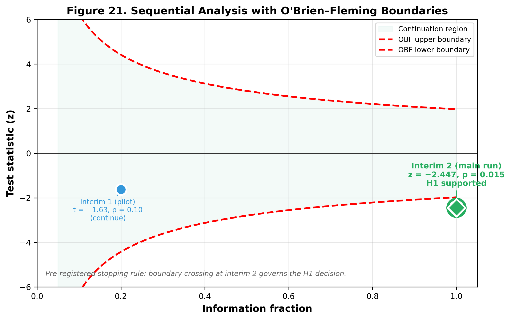
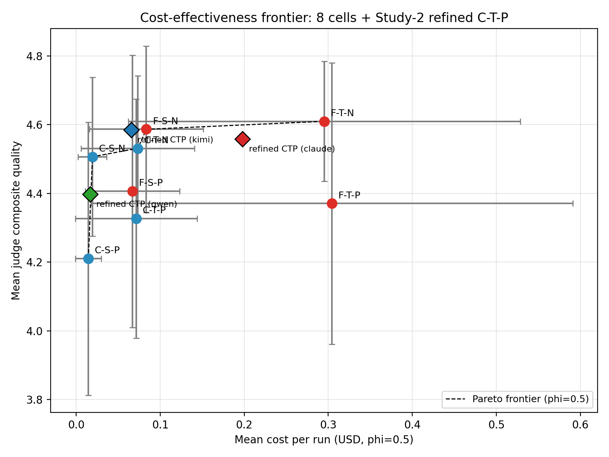
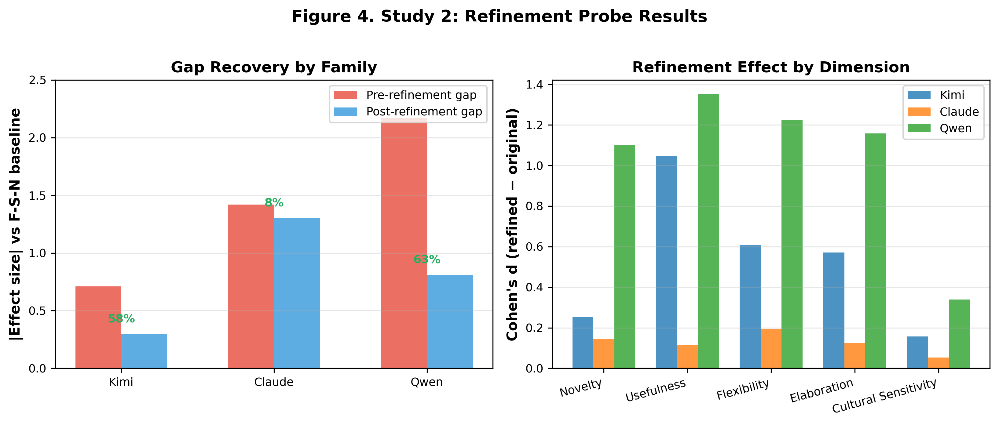
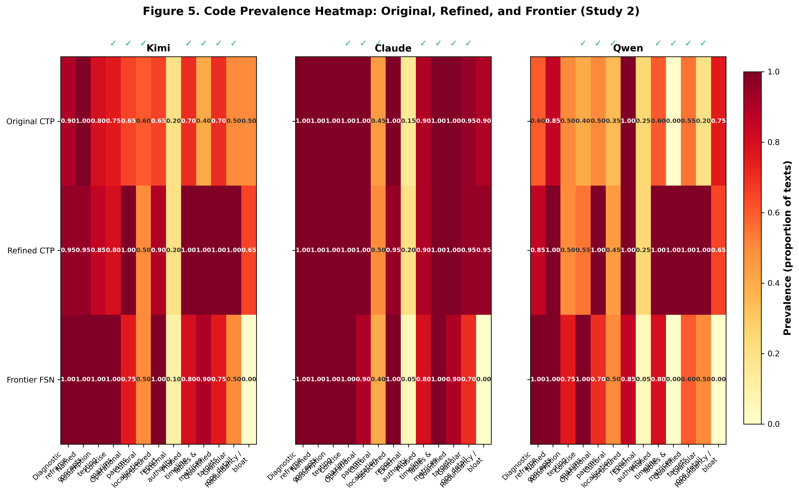
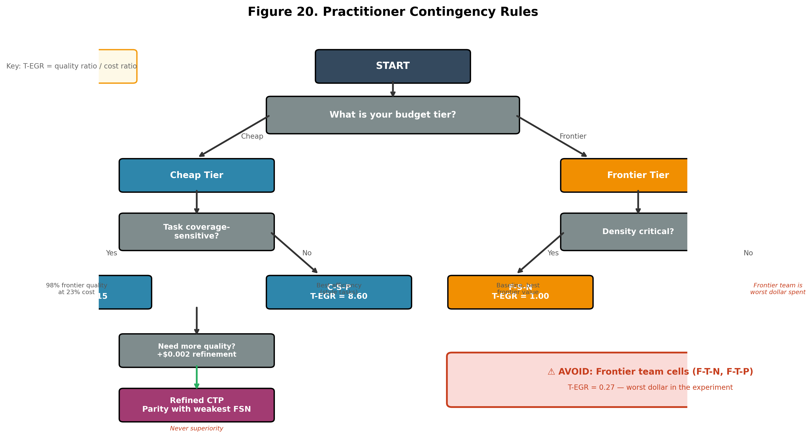

*A practitioner-oriented executive summary with budget-allocation rules
appears at the end of the paper
([10](#sec:exec-summary){reference-type="ref+label"
reference="sec:exec-summary"}).*

# List of Abbreviations {#list-of-abbreviations .unnumbered}

  **Abbr**                          **Definition**
  --------------------------------- ----------------------------------------------
  $\ensuremath{\mathit{BF}}_{10}$   Bayes factor in favor of $H_1$ over $H_0$
  C-S-N                             lower-tier solo, no persona
  C-S-P                             lower-tier solo, persona
  C-T-N                             lower-tier team, no persona
  C-T-P                             lower-tier team, persona
  F-S-N                             frontier solo, no persona
  F-S-P                             frontier solo, persona
  F-T-N                             frontier team, no persona
  F-T-P                             frontier team, persona
  EGR                               Efficiency Gain Ratio
  FDR                               false discovery rate
  FLOPs                             floating-point operations
  FSN                               frontier solo, no persona (baseline)
  ICER                              incremental cost--effectiveness ratio
  IRR                               inter-rater reliability
  JZS                               Jeffreys--Zellner--Siow (Bayes factor prior)
  LLM                               large language model
  LMM                               linear mixed model
  LOO                               leave-one-out
  OBF                               O'Brien--Fleming (spending function)
  SESOI                             smallest effect size of interest
  T-EGR                             Tiered Efficiency Gain Ratio
  TOST                              two one-sided tests (equivalence)

# Introduction {#sec:intro}

Recent work has moved from single-model inference to the orchestration
of multiple language-model calls: refinement pipelines chain builder,
critic, and refiner steps into structured workflows
[@WeiEtAl2022; @ShinnEtAl2023; @YaoEtAl2023]; agent teams assign social
roles and have models debate toward an answer [@LiangEtAl2024]; and
panels of judges aggregate verdicts across models
[@ZhengEtAl2023; @VergaEtAl2024]. Across these designs runs an implicit
economic claim --- that *structure can substitute for model tier*. A
practitioner who cannot afford a frontier model, the argument runs, can
reach comparable output quality by composing cheaper models into an
orchestrated system. If true, the claim reshapes how organizations
price, budget, and architect generative-AI products. If false,
orchestration is at best a marginal convenience and at worst a cost
multiplier that never reaches frontier quality.

Prior empirical work on generative AI is encouraging but silent on this
specific claim. Controlled productivity studies show that a single
generative assistant raises output quality and reduces task time
[@NoyZhang2023; @BrynjolfssonLiRaymond2023], yet they treat the model as
a given, single-agent capability. A field experiment with consultants
documented a "jagged technological frontier": large gains inside the
model's capability boundary, large losses outside it
[@DellAcquaEtAl2023]. Neither study varies the structure around the
model. Multi-agent and ensemble work shows that sampling, debate, and
tree search can improve accuracy
[@WangEtAl2023; @LiangEtAl2024; @YaoEtAl2023], but the gains are
reported without cost-matched comparison to a stronger single model. A
nascent theory of test-time compute predicts that, for fixed problem
difficulty, more inference compute on a smaller model can outperform
less inference compute on a larger one [@SnellEtAl2024], but its
predictions are in units of FLOPs, not dollars, and only on verifiable
tasks.

Four gaps follow. First, no factorial, cost-matched comparison of
orchestrated lower-tier models versus frontier solo exists on open-ended
tasks. Second, no mechanistic account explains *why* orchestration
succeeds or fails. Third, no economic metric is robust to the
price-assumption choices that inevitably shape per-run costing. Fourth,
orchestration studies almost invariably freeze a *human-designed*
pipeline: whether models can design their own workflows, and whether the
resulting cost--quality economics transport across model families and
fresh problems, is largely untested --- leaving practitioners unable to
tell whether a winning configuration can be copied or must be
re-measured.

This paper addresses all four. We run a pre-registered
$2 \times 2 \times 2$ (tier $\times$ structure $\times$ persona)
factorial experiment over five model families. The third factor --- a
fixed cultural persona applied to each pipeline role, carried from our
prior work on persona economics [@Hariri2026b] --- is a secondary,
boundary question rather than part of the core tier--structure claim; it
produces a large negative effect, with personas raising cost while
degrading quality
([4.1.2](#sec:persona-penalty){reference-type="ref+label"
reference="sec:persona-penalty"}). Nineteen confirmatory business
problems are drawn from a 30-problem domain-stratified universe, with 11
problems reserved for feasibility gating per the pre-registered protocol
--- a separation that keeps feasibility probes from anchoring
confirmatory inference [@AlbersLakens2018]. The experiment produces
1,900 generation--judgment runs, measured by a blinded three-judge panel
from families disjoint from every generator. Cost is stored as tokens
and re-priced through a frozen price vector under three blended
input/output ratios, so every reported dollar is reproducible and
re-priceable. A second study applies a cheaper, add-only refinement pass
to the orchestrated outputs and codes the qualitative differences
between original, refined, and frontier answers, testing the mechanistic
prediction that orchestration buys coverage while the frontier wins on
density. A third study unfreezes the pipeline itself: across the same
five families, models auto-design their own workflows, which we compare
against frontier-designed and our frozen human-designed instruments, and
we test whether the resulting cost--quality economics transport to 30
fresh problems in a pre-registered replication.

Six contributions follow:

1.  **The first cost-matched, pre-registered factorial** testing whether
    orchestration structure substitutes for model tier on open-ended
    business tasks --- with negative superiority results reported as
    primary findings, not buried.

2.  **A new economic metric, T-EGR** (quality per dollar, relative to
    the frontier baseline) and a cost--quality Pareto frontier shown to
    be robust to price assumptions.

3.  **A mechanistic explanation** of why substitution stops short:
    orchestration buys *coverage* while the frontier wins on *density*
    --- a gap a low-cost refinement pass narrows but never closes.

4.  **A pipeline-authorship finding**: who designs the workflow barely
    matters, but the economics are family-specific, so orchestration
    must be *measured per deployment, not looked up*.

5.  **Practitioner contingency rules** mapping each budget tier and task
    type to the pipeline architecture with the highest expected return.

6.  **External validity --- and its boundary**: across two confirmatory
    replications on fresh problems and a widened family universe, the
    core cost--quality economics generalize, while the contingent
    nuances do not, identifying which orchestration findings
    practitioners can rely on.

The paper proceeds as follows. [2](#sec:lit){reference-type="ref+label"
reference="sec:lit"} reviews related literature.
[3](#sec:method){reference-type="ref+label" reference="sec:method"}
describes the pre-registered design, apparatus, and analysis, including
an AI-assisted research disclosure
([3.9](#sec:ai-disclosure){reference-type="ref+label"
reference="sec:ai-disclosure"}).
[4](#sec:results){reference-type="ref+label" reference="sec:results"}
presents the three studies as a single buyer's decision journey: Study 1
asks whether structure substitutes for model tier, Study 2 asks why
substitution stops short of the frontier, and Study 3 asks who should
design the pipeline. [5](#sec:discussion){reference-type="ref+label"
reference="sec:discussion"} discusses theoretical and practical
implications; [6](#sec:managerial){reference-type="ref+label"
reference="sec:managerial"} translates the findings into budget rules
and an operating model for practitioners.
[7](#sec:limitations){reference-type="ref+label"
reference="sec:limitations"} acknowledges limitations.
[8](#sec:future){reference-type="ref+label" reference="sec:future"}
outlines future directions.
[9](#sec:conclusion){reference-type="ref+label"
reference="sec:conclusion"} concludes.

# Literature Review {#sec:lit}

This review synthesizes four streams of research: (i) measured
productivity effects of generative AI, (ii) multi-agent and ensemble
generation methods, (iii) LLM-as-a-judge evaluation methodology, and
(iv) open-science methods for economic measurement. We then integrate
these streams with our own prior work on personas and efficiency metrics
to articulate the research gap that motivates this study.

## Productivity effects of generative AI

### Measured gains in knowledge work

Three controlled studies establish that generative AI raises
knowledge-work productivity, but they also reveal that the gains are
conditional and bounded. @NoyZhang2023 randomized 444 mid-level
professionals to ChatGPT-assisted and control arms on professional
writing tasks: assistance reduced completion time by 0.8 standard
deviations and raised output quality by 0.4 standard deviations, with
the largest quality gains among initially lower-performing workers --- a
compression of the performance distribution. @BrynjolfssonLiRaymond2023
observed 5,179 customer-support agents using a generative assistant in
the field and found a 14% average productivity increase, concentrated
among novice and low-skilled workers (+34%), consistent with the model
diffusing behaviors of high-ability agents across the workforce.

A critical limitation unites these studies: both treat the model as a
*given, single-agent capability*. The unit of analysis is one model
call, not an orchestrated system. The professional-writing and
customer-support tasks they study are also relatively closed-form: the
desired output is well-specified (a support response, a draft document),
and quality can be partially verified against ground truth. Open-ended
strategic tasks --- the domain of this paper --- have no verifiable
correct answer, which changes both the nature of the "frontier" and the
applicability of the productivity gains documented above.

### The jagged frontier and its boundary

The boundary of these gains is the central caution. @DellAcquaEtAl2023
ran a field experiment with 758 consultants on realistic professional
problems and documented a "jagged technological frontier": inside the
model's capability boundary, consultants completed 12.2% more tasks,
25.1% faster, with 40% higher quality; outside it, consultants using the
model were 19 percentage points less likely to produce correct solutions
than controls. Two productive behavioral strategies emerged ("centaurs"
dividing work at the boundary, "cyborgs" interleaving with the model),
but neither changed the location of the boundary itself.

The jagged frontier concept is especially consequential for open-ended
tasks. In closed-form domains (arithmetic, code, support scripts), the
boundary is sharp: a solution is either correct or not. In open-ended
business strategy, the boundary is diffuse --- there is no single
correct answer, only better or worse responses. This diffuseness creates
a fundamental ambiguity: when a cheaper model produces a plausible but
suboptimal strategy, the user may not know they are "outside the
frontier" until the solution fails in deployment. The open question this
paper addresses is whether *orchestration structure* can shift the
effective capability frontier for these open-ended tasks --- and at what
cost.

## Multi-agent systems, reasoning, and inference-time compute

### From chain-of-thought to structured reasoning

The modern reasoning literature begins with the observation that
language models solve complex problems better when they generate
intermediate reasoning steps. @WeiEtAl2022 introduced chain-of-thought
(CoT) prompting: appending exemplars that show step-by-step reasoning
before the final answer elicited comparable reasoning in the model,
dramatically improving performance on arithmetic, commonsense, and
symbolic reasoning tasks. The CoT paradigm reframed language-model
inference from single-shot generation to *structured multi-step
deliberation* --- a conceptual shift that enabled the orchestration
methods reviewed below.

CoT's direct descendant in the accuracy--cost tradeoff space is
self-consistency. @WangEtAl2023 showed that sampling a diversity of
reasoning paths from a single model and taking a majority vote over
final answers improves arithmetic, commonsense, and symbolic reasoning
well beyond CoT decoding alone. The result establishes the general
principle that parallel sampled calls can be converted into accuracy.
Its direct corollary --- that accuracy is bought at a multiplicative
cost in calls and tokens --- is rarely priced against the alternative of
a single stronger model.

### Interactive deliberation: debate, tree search, and agent loops

Moving beyond independent sampling, recent work has explored
*interactive* structures in which model instances influence each other.
@LiangEtAl2024 showed that multiple LLM instances proposing answers,
critiquing each other's responses, and refining their own over debate
rounds improves factuality and reasoning on arithmetic and knowledge
benchmarks, encourages divergent thinking, and reliably converges to
shared answers. @YaoEtAl2023 extended the reasoning structure from
linear chains to branching trees: Tree of Thoughts treats each reasoning
step as a node in a search graph, allowing the model to explore multiple
reasoning paths, backtrack from dead ends, and select the most promising
branch --- deliberate problem solving rather than single-path
generation.

These works demonstrate that structure (sampling, aggregation, critique
loops, tree search) adds quality beyond a single call. What they do not
provide is a cost-matched factorial comparison: prior multi-agent
studies report quality gains without measuring dollars, and without
comparing orchestrated lower-tier models against an un-orchestrated
frontier model on identical problems. The substitution claim --- that
structure can stand in for model tier --- is therefore assumed, not
tested.

### The test-time compute hypothesis

A nascent theoretical framework reframes the model-tier-versus-structure
tradeoff as an allocation problem. @SnellEtAl2024 demonstrated that
scaling inference-time computation (more tokens, verifier-based search,
iterative refinement) can be more effective than scaling model
parameters for improving performance on reasoning benchmarks. Their
compute-optimal curve predicts that for any fixed problem difficulty,
there exists an optimal allocation between training compute (model size)
and inference compute (test-time search). Below that optimum, a smaller
model with more inference compute outperforms a larger model with less;
above it, the larger model wins.

This framework is the closest theoretical grounding for the
"orchestration economics" claim, but it remains limited in three ways
that motivate our study. First, @SnellEtAl2024 measure *verifiable*
reasoning tasks (math, code) where a verifier can score intermediate
steps; open-ended business strategy has no verifier. Second, their
test-time compute is *search-based* (sampling + scoring), whereas the
multi-agent literature uses *structural* compute
(builder--critic--refiner pipelines, debate rounds) --- the two may have
different cost--quality curves. Third, and most fundamentally, their
analysis is in units of FLOPs, not dollars: the practitioner facing an
API bill cannot pay in FLOPs. A dollar-matched empirical test is
missing.

### Self-refinement and the limits of iterative improvement

The final reasoning structure relevant to this study is self-refinement:
a model critiquing and revising its own output. @ShinnEtAl2023
introduced Reflexion, in which a language agent maintains a reflective
memory of past failures and uses verbal reinforcement learning to
improve subsequent trials. On coding and decision-making tasks,
Reflexion outperformed single-shot baselines and even standard CoT by
learning from its own errors.

Self-refinement raises a hypothesis directly tested in our Study 2: if a
cheaper model's initial output is below the frontier, can a low-cost
refinement pass close the gap? The multi-agent and self-refinement
literatures imply that iterative improvement should raise quality. But
they do not tell us whether the improvement is sufficient to reach
parity with a frontier model that was not itself refined --- the
marginal comparison that determines substitution. Nor do they tell us
*why* refinement succeeds or fails on open-ended tasks. Our qualitative
coding protocol ([3.6.5](#sec:qual-coding){reference-type="ref+label"
reference="sec:qual-coding"}) is designed to answer this mechanistic
question.

## LLM-as-a-judge evaluation methodology

Because our outcomes are open-ended business solutions, evaluation
itself is a design object. @ZhengEtAl2023 established LLM-as-a-judge as
a scalable evaluation paradigm, showing strong agreement between strong
judge models and human preferences on pairwise comparison tasks, while
documenting three systematic biases that threaten validity: position
bias (preferring the candidate presented first), verbosity bias
(preferring longer outputs), and self-enhancement bias (preferring
outputs from the same model family as the judge). Their mitigations ---
swapping candidate order, controlled few-shot examples, length
normalization --- inform our blinding and order-shuffling protocol.

The self-enhancement bias is particularly acute for multi-agent studies.
If the generator and judge share model architecture, the judge may
reward the generator's stylistic conventions rather than substantive
quality. @VergaEtAl2024 extended the single-judge design into a jury: a
Panel of LLM evaluators (PoLL) composed of several smaller models from
different families correlated better with human judgments than a single
large judge, at lower cost, while mitigating the self-preference bias
that afflicts same-family evaluation. Our evaluation framework inherits
this logic directly: three judges from families disjoint from all
generators, each under three frozen prompt variants, scoring blind to
cell and family. Because no judge shares a family with any generator,
the "persona penalty" reported in
[4.1.2](#sec:persona-penalty){reference-type="ref+label"
reference="sec:persona-penalty"} cannot be attributed to same-family
self-enhancement bias [@ZhengEtAl2023].

## Open-science methods and economic measurement

The fourth stream supplies the discipline this paper applies.
@NosekEtAl2018 argue that preregistration distinguishes confirmatory
from exploratory analysis, converting transparency into credibility; our
protocols and their amendments were frozen before the corresponding
computations ran and are timestamped in the OSF registration chain
([1](#tab:osf-registrations){reference-type="ref+label"
reference="tab:osf-registrations"}), which also discloses the two
exceptions. @SteegenEtAl2016 show that conclusions can vary across
reasonable analytic choices and recommend reporting a multiverse of
analyses; our price-assumption panel (three blended input/output ratios)
and pre-registered robustness battery implement this idea.
@SandveEtAl2013 codify reproducible computational research --- versioned
scripts, recorded steps, stable environments --- which our token ledger
and frozen configuration files follow.

Two statistical practices complete the foundation. @AlbersLakens2018
demonstrate that effect sizes estimated from pilots are unstable and
bias follow-up power analyses, so pilot data must never anchor
confirmatory claims; accordingly, our pilot data informed only
feasibility gating, never the confirmatory analysis. @Lakens2013 makes
the case for reporting effect sizes with confidence intervals to support
cumulative science; we report Welch's $d$ with bootstrap intervals
throughout. @Cohen1960's $\kappa$ coefficient provides our inter-rater
and coder-agreement metric.

Finally, measuring the economics of inference requires separating
quantity from price. @Diewert1976 formalized the decomposition of value
changes into price and quantity components in index-number theory; we
apply the same logic by storing tokens (quantity) and multiplying by a
frozen price vector, so every reported dollar is reproducible and
re-priceable. @TomlinsonEtAl2024 quantify the environmental footprint of
generative tasks, reinforcing that inference cost --- economic and
environmental --- is a first-order design variable rather than an
implementation detail.

## Integration: from persona economics to orchestration economics

Our own prior work supplies the immediate empirical background. In a
cross-architecture evaluation of cultural personas across seven large
language models, persona effectiveness followed a contingency model
rather than a universal rule, and the Efficiency Gain Ratio (EGR) showed
that small models with personas achieved superior performance at 40--88%
lower cost [@Hariri2026b]. The same line of work measured creativity
with multi-judge panels over thousands of generated business solutions,
establishing Novelty as the best-agreed creativity dimension
[@Hariri2025a], and showed that team composition effects are contingent
on task verifiability [@Hariri2025b].

Integrating the four streams above with this lineage yields the gap and
a pre-registered hypothesis set spanning all three studies, each element
grounded in the literature or in our prior work. The Study 1 labels
$H_1$--$H_5$ follow the registered protocol exactly (OSF registration
[`osf.io/mjb8x`](https://osf.io/mjb8x), Protocol 01): $H_1$ is the
primary tier $\times$ structure interaction; $H_2$, $H_3$, and $H_4$ are
the tier, structure, and persona main effects; $H_5$ is the structure
$\times$ persona interaction. Studies 2 and 3 add their own
pre-registered hypotheses below (Protocols 09 and 13).

**Substitution hypothesis ($H_1$):** The test-time compute framework
[@SnellEtAl2024] motivates the prediction that structure can substitute
for model tier at the lower-tier end of the compute-optimal curve. We
test this prediction with a factorial tier $\times$ structure design,
priced in dollars, on open-ended tasks where no verifier exists. If the
hypothesis holds, team structure should raise quality more for cheaper
models than for frontier models.

**Main-effect hypotheses ($H_2$, $H_3$):** The registered protocol also
specifies the tier main effect ($H_2$: frontier models score higher than
their lower-tier siblings, averaged over structure and persona) and the
structure main effect ($H_3$: teams score higher than solos, averaged
over tier and persona). We report both as secondary context for the
economic analysis.

**Persona hypotheses ($H_4$, $H_5$):** Our prior work [@Hariri2026b]
showed that cultural personas shift quality within single-model cells.
$H_4$ extends the registered claim to this design: persona-loaded
conditions should score higher than no-persona conditions, averaged over
tier and structure. $H_5$ adds that the persona effect should be larger
for team structures than for solo structures (personas amplify
structural rigor). If personas primarily add stylistic variation without
substance, the persona-loaded cells should instead be Pareto-dominated
by their no-persona twins.

**Refinement hypothesis (Study 2, Protocol 09):** The self-refinement
literature [@ShinnEtAl2023] suggests that a low-cost critique-and-revise
pass can recover quality gaps. Study 2 tests whether a frozen, add-only
refiner can close the residual gap between orchestrated lower-tier
outputs and frontier outputs --- and whether the mechanism is additive
coverage (more structure) or compressed insight (better density).
Study 2 was pre-registered as a separate study before any refinement
run, with its own feasibility gate (G1), superiority gate (G2), and
three directional criteria (H2.1--H2.3) frozen in the decision log
(Protocol 09, decisions D39--D40).

**Authorship hypotheses (Study 3, Protocol 13):** Every pipeline in the
literature above --- and in Studies 1--2 --- is *human-designed*; the
registered-but-unexecuted A7 arm isolated authorship as the one design
variable left untested, and Study 3 executes it. Across the same five
families, the cheap model either authors and runs its own workflow
(D-SELF) or runs one authored by the frontier flagship (D-FRONT). The
primary hypothesis is *directional*: frontier-authored pipelines
outperform self-authored ones (H-D1: D-FRONT $>$ D-SELF), on the ground
that design capability transfers through authored structure --- the same
logic by which a cross-family refiner beat within-family editors in
Study 2b. Two further hypotheses complete the set: that model-authored
pipelines are at least as good as the frozen human-designed instrument
(H-D2, two-sided), and that frontier-authored design stays cheaper per
quality point than frontier solo once design tokens are charged (H-D3,
economic). A pre-registered confirmatory replication (Protocol 16) then
converts the family-level effects into binding directional gates,
testing whether the cost--quality ordering transports to fresh problems.

[3](#sec:method){reference-type="ref+label" reference="sec:method"}
specifies the pre-registered design, apparatus, and analysis plan that
test this hypothesis set, with every run priced in dollars;
[4](#sec:results){reference-type="ref+label" reference="sec:results"}
reports the outcomes. One hypothesis is mechanistic rather than purely
economic: the qualitative coding protocol
([3.6.5](#sec:qual-coding){reference-type="ref+label"
reference="sec:qual-coding"}) tests the refinement hypothesis's
prediction that orchestration buys *coverage* while the frontier wins on
*density*, by coding original, refined, and frontier answers against a
frozen codebook.

# Methodology {#sec:method}

## Research Design

The experiment is a $2 \times 2 \times 2$ between-cell factorial with
model *family* as a blocking factor. The three manipulated factors are
**tier** (frontier flagship vs. lower-tier sibling within the same
generation), **structure** (solo single call vs. three-step team of
builder $\to$ critic $\to$ refiner), and **persona** (none vs. a fixed
cultural-persona mapping applied to each team role). Five model families
--- Kimi, Qwen, GPT-5.6, Claude, and Gemini --- supply both frontier and
cheaper tiers. Thirty business problems, stratified across
knowledge-work domains, are identical across all cells; no instruction
wrappers are added to the rendered prompt. Every design and statistical
decision is time-stamped, numbered (D1--D54), and registered in a frozen
decision log; twelve protocols and their amendments were registered
before the corresponding computation ran, maintaining the
confirmatory/exploratory separation required by preregistration
discipline [@NosekEtAl2018].

This paper reports three studies: Study 1 is the factorial experiment
($H_1$--$H_5$); Study 2 is the refinement probe and qualitative coding
(Protocol 09); Study 3 manipulates pipeline design authorship with
model-authored pipelines (Protocol 13,
[4.3](#sec:study3){reference-type="ref+label" reference="sec:study3"}).
A confirmatory replication wave (Protocol 12,
OSF [jg49x](https://osf.io/jg49x)) tests the persistence of the core
claims and the study's exploratory findings out-of-sample
([4.1.7](#sec:wave){reference-type="ref+label" reference="sec:wave"}).

::: {#tab:osf-registrations}
  **Study / Protocol**                **OSF**                         **Registered**   **Role**
  ----------------------------------- ------------------------------- ---------------- -------------------------------------------
  Study 1 (Protocols 01--04, A1/A2)   [mjb8x](https://osf.io/mjb8x)   2026-08-06       factorial pre-registration$^{\dagger}$
  Study 2b (Protocol 11)              [83c9u](https://osf.io/83c9u)   2026-08-22       refinement extension (GPT, Gemini)
  Wave (Protocol 12)                  [jg49x](https://osf.io/jg49x)   2026-08-23       Study 1 confirmatory replication
  Study 3 (Protocol 13, v2)           [bwc93](https://osf.io/bwc93)   2026-08-29       authorship study (operative)$^{\ddagger}$
  Study 3 (Protocol 13, G1)           [639eq](https://osf.io/639eq)   2026-08-29       feasibility-gate clarification
  Study 3 replication (Protocol 16)   [zkm8v](https://osf.io/zkm8v)   2026-08-30       family-moderation transport test

  : OSF registration chain (Open-Ended Registrations branched from
  project node `8pwej`). The text cites Protocol numbers; this table is
  the authoritative GUID map.
:::

::: minipage
$^{\dagger}$ mjb8x *memorializes* the Study 1 pre-registration: the
protocol and decision log were frozen before data collection, but this
OSF timestamp post-dates main-run generation (as the registration itself
discloses).\
$^{\ddagger}$ bwc93 is the operative Study 3 registration, superseding
the v1 registration (9ukjz) after a pre-analysis instrument audit; the
73 v1 runs were archived and never pooled.
:::

**Registered but unexecuted arms (disclosure).** The Study-1
pre-registration also specified four special mechanism arms --- A5 (a
critic-gated WHILE loop on the cheap team), A6 (a cost-matched
frontier-solo baseline), A7 (an adaptive per-problem pipeline designer),
and A8 (a shuffled persona-to-role mapping) --- each with a
pre-registered feasibility/futility gate. These gates were never
evaluated and the arms were never executed within Study 1: the main run
was scoped to the eight factorial cells, and Studies 2/2b and the
replication wave took budgetary priority. Per no-file-drawer discipline
we disclose their registered-but-unexecuted status here rather than
silently dropping them. The design-authorship question behind A7 has
since been executed as Study 3 (Protocol 13;
[4.3](#sec:study3){reference-type="ref+label" reference="sec:study3"});
the loop question behind A5 is the subject of a separate pre-registered
protocol ([8](#sec:future){reference-type="ref+label"
reference="sec:future"}).

<figure id="fig:design" data-latex-placement="ht">

<figcaption>Experimental Design: 2 × 2 × 2 Factorial + Apparatus.</figcaption>
</figure>

## Models Evaluated {#sec:models}

### Frontier Models (Five Families)

Each family contributes its current *mainline* flagship, pinned on
2026-07-30: `kimi-k3`, `qwen3.7-max-2026-06-08`, `gpt-5.6-sol`,
`claude-opus-5`, and `gemini-3.1-pro-preview`. Above-mainline tiers
(e.g. `claude-fable-5`) are deliberately excluded because they would
break cross-family comparability. Gemini's preview status carries a
pre-registered fallback to `gemini-2.5-pro` if the model is retired
mid-experiment; the fallback was never invoked. All models run with
generator temperature $= 1$, a uniform value forced by the OpenAI and
Moonshot APIs (which reject other values) and applied identically across
families for *ceteris paribus* comparability (D27).

### Lower-Tier Siblings

Each family contributes one lower-tier model from the same generation:
`kimi-k2.6`, `qwen3.7-plus-2026-05-26`, `gpt-5.6-luna`,
`claude-haiku-4-5-20251001`, and `gemini-3.1-flash-lite`. Price ratios
(frontier : cheaper) range from 3.4$\times$ to 8$\times$ across
families. Family-level heterogeneity in price ratio is absorbed by the
family random effect in our mixed-model analysis
([3.6.2](#sec:inferential){reference-type="ref+label"
reference="sec:inferential"}); it is not a confound of the primary tier
$\times$ structure test.

## Orchestration Structures and Personas

**Solo** runs invoke a single model call on the rendered problem.
**Team** runs execute a three-step pipeline --- builder produces a
draft, critic critiques it, refiner produces the final answer --- with
all intermediate outputs discarded from the judged answer (and therefore
from the quality score) but retained in the cost ledger (a disclosed
cost bias, favorable to the cheaper-team cells). Persona is implemented
as a fixed mapping from role (builder/critic/refiner) to a cultural
persona description, identical across all problems and families
[@Hariri2026b]. The mapping is pre-registered and never varied
per-problem; it is therefore a treatment level, not a confound.

## Stimuli and Response Generation

Thirty domain-stratified business problems are used. Fifteen are
inherited verbatim from a prior validated set [@Hariri2025a]; ten were
drafted post-cutoff to control for contamination and validated as
structurally identical; the remainder extend the grid to cover five
domains equally. Each problem is rendered as
`background_context + "\n\n" + business_problem` with no instructional
wrapper --- adding wrapper text would introduce an unmeasured prompt
treatment. Generator temperature is fixed at 1
([3.2](#sec:models){reference-type="ref+label" reference="sec:models"}).
Every run is time-stamped and flagged for whether it executed inside the
pre-registered preferred window (14:00--00:00 UTC), which captures the
Qwen off-peak discount; window-free providers (Kimi, Together-hosted
models, Western providers) are time-invariant and therefore unaffected.
DeepSeek pricing was stable throughout the experiment (no peak-surge
window was in effect during the execution period).

## Evaluation Framework {#sec:eval}

### Judge Model Selection

Three judges from families disjoint from every generator:
`deepseek-chat` (resolved to `deepseek-v4-flash`), `zai-org/GLM-5.2`,
and `meta-llama/Llama-3.3-70B-Instruct-Turbo`. The disjointness
rule (D33) guards against self-enhancement bias [@ZhengEtAl2023]: even
when deepseek is the registered fallback generator, the fallback was
never invoked, so disjointness holds in the executed data.

### Scoring Rubric

Six 1--5 dimensions are scored: **Novelty, Usefulness, Flexibility,
Elaboration, Cultural Sensitivity, and an aggregate Practicality**. The
composite primary outcome is the mean of the first five dimensions.
Three prompt variants are used per judge, frozen verbatim and never
re-optimized after a prior judge-prompt optimization attempt collapsed
$\kappa$ in earlier work [@Hariri2025a]. Every solution is scored by all
three judges under all three variants (nine scores per solution), with
candidate order shuffled per variant to neutralize position bias
[@ZhengEtAl2023]. Judges run at temperature 0 for determinism.

### Inter-Rater Reliability

Pairwise judge correlations on per-run composite scores are 0.87
(deepseek--zhipu), 0.61 (deepseek--meta), and 0.49 (meta--zhipu). The
panel-level reliability exceeds any single judge's correlation with the
latent quality; this mirrors the jury logic of @VergaEtAl2024 in which
diversity of smaller judges outperforms a single large judge.

## Statistical Analysis

### Effect Sizes

Welch's $d$ with bootstrap 95% confidence intervals (5,000 resamples,
seed 42) throughout [@Lakens2013]. Estimation-first reporting:
intervals, not $p$-values, carry the weight of the argument; $p$-values
are reported for completeness and to comply with sequential-analysis
boundaries ([3.6.2](#sec:inferential){reference-type="ref+label"
reference="sec:inferential"}).

### Inferential Statistics {#sec:inferential}

The primary test of $H_1$ is the pre-registered interaction contrast
$d = (FT - FS) - (CT - CS)$, expected negative (team structure helps
cheaper models more than frontier models). Inference uses a mixed model
with random effects for *problem* and *family*, solving the
pseudo-replication identified in the author's prior work [@Hariri2026b].
Sequential analysis with an O'Brien--Fleming spending function
(protocol 03) governs interim looks and the final stopping boundary; the
Bayesian JZS Bayes factor is reported as recommended and pre-registered
in the robustness battery[^1] but does not gate the decision.
Family-wise corrections within secondary hypotheses use
Benjamini--Hochberg FDR ($\alpha = 0.05$); Holm is used for the small
set of directional family comparisons in Study 2.

### Economic Analysis

Cost is stored as tokens in a run-level ledger and re-priced through a
frozen price vector (`config/price_vector.json`, version 2026-07-30).
Because the ledger does not split input from output tokens, cost is
computed under a blended price
$\mathrm{blend}(\varphi) = \varphi\cdot p_{\mathrm{out}} +
(1 - \varphi) \cdot p_{\mathrm{in}}$ with a primary $\varphi= 0.50$ and
a sensitivity panel $\varphi\in \{0.25, 0.50, 0.75\}$ (@Diewert1976
provides the price--quantity decomposition precedent; @SteegenEtAl2016
the multiverse-robustness precedent). Frontier-membership claims must be
stable across all three $\varphi$. The **Tiered Efficiency Gain Ratio
(T-EGR)** is
$(\mathrm{Quality}_{\mathrm{cell}} / \mathrm{Quality}_{F\text{-}S\text{-}N})
/ (\mathrm{Cost}_{\mathrm{cell}} / \mathrm{Cost}_{F\text{-}S\text{-}N})$,
computed within each family and pooled; F-S-N is the baseline. **ICER**
is reported relative to the lowest-cost cell. Judge cost is excluded
from unit T-EGR (it is shared infrastructure, not cell compute; a
disclosed exclusion).

### Robustness Checks

The pre-registered battery (Amendment A2, items A2.1--A2.7) comprises
bootstrap confidence intervals on all primary contrasts (A2.1),
Benjamini--Hochberg FDR on secondary contrast families (A2.2), a Type-II
factorial ANOVA sensitivity layer with partial $\eta^2$ (A2.3), JZS
Bayes factors for non-significant contrasts (A2.4), leave-one-family-out
sensitivity (A2.5), leave-problems-out generalizability (A2.6), and a
sensitivity power analysis in place of post-hoc power (A2.7). After the
data lock, an explicitly exploratory amendment (A3, registered in the
decision log but not part of the OSF package) added two analyses:
empirical-Bayes partial pooling of per-family interaction estimates
(A3.3) and a random-effects meta-analysis across the five families
(A3.4). All A3 results are labeled exploratory wherever reported. The
meta-analysis confirms the interaction generalizes (pooled $d = -0.270$,
$I^2 = 28.5\%$).

### Qualitative Coding Protocol (Study 2) {#sec:qual-coding}

Thirty triples (original CTP / refined CTP / same-problem same-family
FSN) are sampled deterministically (seed 20260801, 10 per family). Two
blinded LLM coders perform a two-wave coding: free induction on a
subset, then closed coding against a frozen 13-code codebook.[^2] The
codebook is organized around three research questions: **RQ1** asks
whether orchestration adds *insight* (compressed reasoning, named
concepts, diagnostic reframing) --- six codes; **RQ2** asks whether
orchestration adds *structure* (scaffolding, timelines, matrices) ---
six codes; **RQ3** asks whether orchestration adds *bloat* (redundancy)
--- one code. Cohen's $\kappa$ gate is 0.70; codes below threshold are
downgraded to medium reliability and disclosed [@Cohen1960]. The prompt
presented to coders contains the three texts only --- no cell label,
family, or score, preserving blind evaluation.

## Validity and Reliability

**Construct validity:** the rubric separates Novelty from
Usefulness/Elaboration, so a stylistic shift (e.g. more discourse
markers from a persona) is not conflated with substantive quality.
**Internal validity:** frozen configurations, blinded judging, shuffled
order, disjoint judge families. **External validity:** single task
domain (English business strategy) is the acknowledged boundary.
**Disclosed threats.** (i) *Uncounted intermediate outputs.* Team
pipelines generate intermediate outputs (drafts, critic feedback) on the
way to the final answer; these are not included in the cost ledger, so
reported team costs are slightly understated. The bias favors the team
cells --- all lower-tier configurations --- and therefore favors the
paper's central claim. It is disclosed but not corrected, since
correcting it could only shrink, not reverse, the cost advantage.
(ii) *Truncation at source.* A small set of very long runs was capped by
the transport layer before storage; each run records whether this
happened, and the affected runs are audited separately rather than
silently excluded.

## Code and Data Availability

All analysis code, the frozen token ledger, judge rationales, the
decision log (D1--D54), and Protocols 09--10 and 13--16 are committed to
the `orchestration-economics` repository. The pre-registration trail is
the OSF registration chain mapped in
[1](#tab:osf-registrations){reference-type="ref+label"
reference="tab:osf-registrations"}: each OSF registration archives its
protocol file, and the table discloses the two exceptions --- the
Study 1 memorialization (mjb8x) and Study 2 (Protocols 09--10), which
are committed to the repository and frozen in the decision log (D39) but
were not separately OSF-registered. A materialized results layer (D54)
ships every statistical test as a flat CSV --- per-solution judge scores
for all studies, the wave gate statistics, the heterogeneity batteries,
and the qualitative codebook with per-code $\kappa$ --- so that no
number in this paper requires re-running code to inspect. A reproduction
runbook [@SandveEtAl2013] lists the commands that regenerate every
number reported in [4](#sec:results){reference-type="ref+label"
reference="sec:results"}.

## AI-Assisted Research Disclosure {#sec:ai-disclosure}

This study used large language models as research tools under continuous
human supervision. Specifically, **Kimi** (Moonshot AI,
`kimi-2.6 and kimi-k3`) and **Qwen** (Alibaba Cloud,
`qwen3.7-max and qwen3.8-max`) were employed in the following
capacities: (1) **ideation** --- brainstorming experimental design
alternatives, hypothesis formulations, and analysis strategies during
the protocol-drafting phase; (2) **code generation** --- producing
initial versions of the execution pipeline, statistical analysis
scripts, and figure-generation code, all of which were reviewed,
corrected, and approved by the author before execution; (3) **audit**
--- reviewing citation accuracy, checking statistical assumptions, and
identifying inconsistencies across protocol documents; (4) **execution**
--- running the generation and judging campaigns through API calls, with
all configurations frozen and logged before each run. Higher-tier models
were employed for ideation, audits, and task execution; lower-tier
models were employed for code generation.

No LLM made unsupervised decisions about the experimental design,
statistical analysis, or the interpretation of results. All twelve
pre-registered protocols, all 54 design decisions (D1--D54), and all
analysis choices were authored, reviewed, and approved by the human
author. Outputs were validated against expected ranges, and every
reported number traces to a frozen, version-controlled analysis
pipeline. The qualitative coding protocol
([3.6.5](#sec:qual-coding){reference-type="ref+label"
reference="sec:qual-coding"}) used two LLM coders with blinded
evaluation --- a design choice that converts the LLM's systematic biases
into a measured inter-rater reliability coefficient ($\kappa = 0.824$)
rather than an unmeasured confound.

A concrete oversight episode illustrates why continuous human audit is
not procedural decoration. When the AI agent implemented the Study 3
design-authorship instrument, it silently introduced two deviations from
the product feature under study (DeeWaanAI's auto-designer): it
hard-capped pipelines at four steps (the platform allows up to seven)
and wrote a bespoke designer prompt, whereas the platform uses a fixed
internal prompt with free-form, task-adapted roles. Both deviations were
invisible in the code's behaviour --- every pilot design complied, so no
error surfaced --- and were caught only when the human author audited
the instrument's rationale against the platform source code before
confirmatory data collection. The instrument was corrected and the
amendment pre-registered *before* the Study 3 campaign (D56). The lesson
for researchers delegating to AI agents: an AI assistant's silent
defaults are themselves experimental-design decisions, and they diverge
from the intended construct precisely where the researcher did not
specify --- audit the rationale behind every parameter, not only the
parameters named in the protocol.

The use of LLMs as evaluation judges
([3.5](#sec:eval){reference-type="ref+label" reference="sec:eval"}) is a
distinct methodological choice from the use of LLMs as research tools:
the judges evaluate *generated business solutions*, not the research
process itself. The disjointness rule (D33) ensures that no judge shares
architecture with any generator, mitigating the self-enhancement bias
documented by @ZhengEtAl2023.

**Platform use and conflict-of-interest disclosure.** All pipeline
generation and execution in Studies 1--3 ran on **DeeWaanAI**
(<https://deewaanai.com>), a commercial orchestration platform; the
auto-designer evaluated in Study 3 and Protocol 16 is DeeWaanAI's
production feature, used unmodified (fixed internal design prompt,
free-form roles, up to seven steps with critic-gated loops). The author
is affiliated with DeeWaanAI, and the findings directly inform the
platform's routing and persona features
([9](#sec:conclusion){reference-type="ref+label"
reference="sec:conclusion"}). This relationship is disclosed so readers
can weight the translational claims accordingly; all protocols, gate
outcomes (including failed ones), and attrition events are
pre-registered and reported as-is, and the full data and code are
publicly available.

# Results {#sec:results}

This section reports three studies that escalate a single business
question --- *orchestrate cheaper models, or pay for the frontier?*
**Study 1** ([4.1](#sec:study1){reference-type="ref+label"
reference="sec:study1"}) tests whether pipeline structure substitutes
for model tier and prices the answer in dollars. **Study 2**
([4.2](#sec:study2){reference-type="ref+label" reference="sec:study2"})
explains *why* that substitution stops short of the frontier.
**Study 3** ([4.3](#sec:study3){reference-type="ref+label"
reference="sec:study3"}) asks whether it matters *who designs* the
pipeline. Each study's headline claims are then stress-tested
out-of-sample in a pre-registered replication, so the rules we recommend
are the ones that survived contact with new data --- and the ones that
did not are reported as failures, not buried.

## Study 1: Does Structure Substitute for Model Tier? {#sec:study1}

### The interaction effect: structure is a lower-tier amplifier {#sec:interaction}

From a resource-allocation perspective, the most important finding is
that pipeline structure delivers higher marginal returns at the lower
tier than at the frontier tier. The pre-registered interaction contrast
is $d = -0.227$ (bootstrap 95% CI $[-0.410, -0.040]$, Welch $t = -2.45$,
$p = 0.0145$), with the sequential-analysis boundary crossed at the
scheduled final look. For a firm making an AI budget decision, this
implies that pipeline dollars are better spent upgrading lower-tier
models to team configurations than adding team overhead to
already-expensive frontier models. The JZS Bayes factor for the
interaction is 1.002 (inconclusive), reported as recommended but not
gating the decision.

The secondary effects provide additional strategic context. The **tier
main effect** ($H_2$: $d = +0.294$, CI $[+0.201, +0.382]$,
$\ensuremath{\mathit{BF}}_{10} = 1.7 \times
10^7$) confirms that frontier models command a quality premium, but the
magnitude is dwarfed by the cost difference. The **structure main
effect** ($H_3$: $d = +0.117$, CI $[+0.030, +0.205]$) shows that teams
slightly outperform solos on average --- a small but consistent
productivity gain from orchestration. The **persona main effect**
($H_4$) is large and in the *opposite* direction to the pre-registered
expectation: $d = -0.691$ (CI $[-0.761, -0.620]$,
$\ensuremath{\mathit{BF}}_{10} = 1.0 \times 10^{50}$). Persona-loaded
cells score *lower* than their no-persona twins, representing a failed
investment in stylistic differentiation. From a business perspective,
personas increase cost while degrading output quality --- a
value-destroying configuration. An exploratory dimension decomposition
(Amendment A3, item A3.5) shows that Novelty is the sole dimension where
personas help (+0.154, $p_{\mathrm{FDR}} = 0.001$) while Usefulness
($-1.024$) and Elaboration ($-0.966$) drive the reversal. The structure
$\times$ persona interaction ($H_5$) is not significant ($F = 1.23$,
$p =
0.27$).

> **Strategic Implication:** Pipeline structure is a lower-tier
> amplifier, not a universal substitute: the marginal return to team
> structure is higher at the lower tier, although the highest absolute
> return remains the lower-tier solo call
> ([4.1.4](#sec:pareto){reference-type="ref+label"
> reference="sec:pareto"}). Personas, by contrast, represent value
> destruction --- they increase cost while degrading quality.

<figure id="fig:sequential" data-latex-placement="ht">

<figcaption>Sequential analysis with O’Brien–Fleming spending function.
The test statistic <em>z</em> = −2.447
crosses the interim-2 boundary |<em>z</em>| ≥ 1.977 (dashed line). The
shaded region is the continuation region. The pre-registered decision is
to stop and report <em>H</em>1 as
supported.</figcaption>
</figure>

<figure id="fig:forest" data-latex-placement="ht">

<figcaption>Quality by Experimental Cell with 95% Confidence
Intervals.</figcaption>
</figure>

### The persona penalty: style without substance {#sec:persona-penalty}

Every persona-loaded cell is Pareto-dominated by its no-persona twin on
the cost--quality plane: at equal or lower cost, the N cell scores
higher on composite quality. The penalty is largest on dimensions that
rubric readers associate with substance (Usefulness, Elaboration),
smallest on the one most susceptible to stylistic signaling (Novelty).
This pattern mirrors the contingency finding in the author's prior work
[@Hariri2026b] and is consistent with the jagged-frontier mechanism
[@DellAcquaEtAl2023]: personas push the generator toward a more stylized
region of its output space that the judge, correctly, penalizes on
substance.

> **Strategic Implication:** Personas degrade output quality while
> increasing cost --- they are value-destroying for knowledge-work
> tasks. Firms should treat them as a failed investment rather than a
> quality lever.

<figure id="fig:persona-radar" data-latex-placement="ht">

<figcaption>Quality-dimension radar for persona-loaded (red, dashed)
versus no-persona (blue, solid) cells. The persona polygon is visibly
smaller on Usefulness and Elaboration, slightly larger on Novelty — the
visual signature of the style-over-substance tradeoff.</figcaption>
</figure>

<figure id="fig:persona-dims" data-latex-placement="ht">

<figcaption>Persona Effect by Quality Dimension
(FDR-Corrected).</figcaption>
</figure>

### The frontier gap: lower-tier teams do not beat frontier solo {#sec:frontier-gap}

Paired comparisons between cheaper-team-with-persona (CTP) and the
frontier-solo-no-persona baseline (F-S-N) are negative in all five
families (kimi $d = -0.71$, claude $d = -1.42$, qwen $d = -2.17$; all
CIs exclude zero after Holm correction). This residual gap is the
empirical target that Study 2
([4.2](#sec:study2){reference-type="ref+label" reference="sec:study2"})
asks a cheap refinement pass to close.

> **Strategic Implication:** As executed, lower-tier teams do not beat a
> single frontier call on matched problems. The substitution thesis is
> bounded: structure improves lower-tier models but cannot fully close
> the frontier gap without additional investment.

### The Pareto frontier: optimal configurations for budget-constrained firms {#sec:pareto}

The cost--quality map is shown in
[6](#fig:cost-scatter){reference-type="ref+label"
reference="fig:cost-scatter"}. At the primary $\varphi= 0.50$, the cell
means are:

::: {#tab:cell-summary}
  **Cell**     **$n$**   **Cost (USD)**   **Quality**     **T-EGR**
  ---------- --------- ---------------- ------------- -------------
  C-S-P            285           0.0145         4.210          8.60
  C-S-N            285           0.0194         4.507          6.15
  C-T-P            285           0.0715         4.327          1.58
  C-T-N            285           0.0734         4.531          1.49
  F-S-P            190           0.0670         4.406          1.36
  F-S-N            190           0.0835         4.586   1.00 (base)
  F-T-N            190           0.2951         4.610          0.27
  F-T-P            190           0.3044         4.370          0.27

  : Cell summary statistics (primary analysis, $\varphi= 0.50$).
:::

<figure id="fig:cost-scatter" data-latex-placement="ht">

<figcaption>Cost-Effectiveness Frontier: 8 Cells + Study-2 Refined
CTP.</figcaption>
</figure>

<figure id="fig:tegr-bars" data-latex-placement="ht">

<figcaption>Tiered Efficiency Gain Ratio (T-EGR) by Cell.</figcaption>
</figure>

The Pareto frontier is **identical across all three $\varphi$**: {C-S-P,
C-S-N, C-T-N, F-S-N, F-T-N}. The dominated set {C-T-P, F-S-P, F-T-P}
contains every persona-loaded team cell --- the economic echo of the
[4.1.2](#sec:persona-penalty){reference-type="ref+label"
reference="sec:persona-penalty"} persona penalty. Frontier membership is
stable across the sensitivity panel, satisfying the pre-registered claim
rule.

<figure id="fig:phi-sensitivity" data-latex-placement="ht">

<figcaption>Pareto frontier stability across the price-assumption
sensitivity panel. Left: <em>φ</em> = 0.25 (input-heavy blend).
Center: <em>φ</em> = 0.50 (primary
analysis). Right: <em>φ</em> = 0.75
(output-heavy blend). The frontier set {C-S-P, C-S-N, C-T-N, F-S-N,
F-T-N} is identical in all three panels, satisfying the pre-registered
cross-<em>φ</em> stability
rule.</figcaption>
</figure>

ICER (vs. the lowest-cost cell, C-S-P): C-S-N is the best buy at
+\$0.016 per point of composite quality; F-T-P is the worst at +\$1.81
per point. The refined kimi C-T-P point (not in the table) sits at
\$0.0654 / quality 4.585 --- absolute parity with pooled F-S-N (4.586)
at 78% of its cost, with the caveat that the paired within-family
comparison remains negative (disclosure
per [4.2.1](#sec:refinement){reference-type="ref+label"
reference="sec:refinement"}).

> **Strategic Implication:** The economically optimal strategy is tier
> substitution at the lower-tier end: a single call from a cheaper model
> (C-S-N) delivers 98% of frontier quality at 23% of the cost, and the
> three-step team variant (C-T-N) buys coverage at 88% of the cost. The
> worst dollar in the experiment is spent on frontier teams --- they
> cost 3.5$\times$ the frontier-solo price for negligible quality gain.

### Robustness across model families and problems

The pre-registered robustness battery (Amendment A2) supports the
[4.1.1](#sec:interaction){reference-type="ref+label"
reference="sec:interaction"} decision. Leave-one-family-out (A2.5): $d$
ranges from $-0.143$ (drop kimi) to $-0.303$ (drop gemini), sign stable
in all five folds; no single family drives the interaction.
Leave-one-problem-out (A2.6): $d$ ranges from $-0.212$ to $-0.247$
across all 19 folds; no problem drives the interaction. Sensitivity
power at the smallest cell ($n = 190$) detects $d = 0.288$ at 80% power;
the observed $|d|
= 0.227$ is detected through the within-subjects contrast over all 1,900
runs rather than per-cell power (A2.7). The Type-II ANOVA sensitivity
layer (A2.3) agrees: tier $\times$ structure interaction $F = 6.90$,
$p = 0.0087$, partial $\eta^2 = 0.0036$; residuals are non-normal, so
the bootstrap intervals and Welch degrees of freedom remain the
authoritative inference, as pre-specified. Length adjustment on the
$H_1$ contrast yields $p = 0.63$ --- the interaction is not a length
confound. The random-effects meta-analysis over the five families
(exploratory, Amendment A3, item A3.4) gives a pooled $d =
-0.270$ (CI $[-0.472, -0.069]$, $z = -2.64$, $p = 0.008$) with
low-moderate heterogeneity ($\tau^2 = 0.015$, $I^2 = 28.5\%$),
confirming the interaction generalizes.

Across all battery perturbations the interaction keeps its sign and the
decision is unchanged. The leave-one-out sensitivity
([9](#fig:loo){reference-type="ref+label" reference="fig:loo"}) and
random-effects meta-analysis
([10](#fig:meta-analysis){reference-type="ref+label"
reference="fig:meta-analysis"}) confirm that no single family, problem,
or outlier drives the result.

> **Strategic Implication:** The findings are robust to judge, model
> family, problem domain, and output-length variations. The interaction
> is small but reliable and generalizes across the five leading LLM
> families --- a stable result for firms making platform-agnostic
> investment decisions.

<figure id="fig:loo" data-latex-placement="ht">

<figcaption>Robustness: Leave-One-Out Sensitivity (A2
Battery).</figcaption>
</figure>

<figure id="fig:meta-analysis" data-latex-placement="ht">

<figcaption>Random-Effects Meta-Analysis: Interaction by
Family.</figcaption>
</figure>

### Exploratory heterogeneity: domain contingency, a capability-gap mechanism, and the persona decomposition {#sec:exploratory-heterogeneity}

**Status declaration.** Everything in this subsection is *exploratory
and post-hoc*: it was formulated after data lock, is not part of the
pre-registered hypothesis set $H_1$--$H_6$, and consists exclusively of
re-analyses of the frozen Study-1 artifacts (no new generation or
judging calls). We report it because it generates concrete, falsifiable
predictions --- which were then tested by the pre-registered
confirmatory replication wave
([4.1.7](#sec:wave){reference-type="ref+label" reference="sec:wave"}).
Anticipating that section: **all three upgrade candidates below (domain
contingency, the capability-gap mechanism, the marketing variance
advantage) FAILED their binding out-of-sample gates** and therefore
remain exploratory; the numbers in this subsection stand as the Study-1
record, and the wave numbers are reported alongside in
[4.1.7](#sec:wave){reference-type="ref+label"
reference="sec:wave"} (Nosek et al., 2018; Open Science Collaboration,
2015).

**Where does heterogeneity live?** Three screening analyses localize the
variation. Problem difficulty does not moderate the team effect
($r = 0.153$, $p = 0.53$ across the 19 problems). Family quality
rankings are remarkably stable across problem domains (Kendall's
$W = 0.922$; Kendall & Babington Smith, 1939), so family choice is
largely domain-invariant. But measurement reliability itself is
domain-heterogeneous: single-judge agreement ICC(3,1) (Shrout & Fleiss,
1979) ranges from $0.235$ (HR/organization) to $0.523$ (marketing), with
panel reliability ICC(3,9) between $0.73$ and $0.91$ --- HR answers are
simply harder for any judge, human or LLM, to score consistently.

**The team effect is domain-contingent.** Pooling the cheap tier, the
team-minus-solo quality effect varies from $+0.004$ (marketing --- the
only domain where teams match solo) through strategy ($-0.036$), HR
($-0.053$), operations ($-0.058$), product innovation ($-0.103$), to
finance ($-0.106$). In marketing the team advantage extends beyond the
mean: team output variance is significantly *lower* than solo
(Brown--Forsythe test, $p = 0.020$; Brown & Forsythe, 1974), and
downside risk shrinks across cells ($P(\text{composite} < 4.0)$: solo
$2.8\%$, team $1.8\%$, frontier $1.1\%$). The ensemble-variance logic is
classical --- combining models reduces error when members are accurate
and diverse (Hansen & Salamon, 1990; Dietterich, 2000) --- but here it
appears only for communication-intensive tasks.

**A capability-gap mechanism.** The family-level team effect correlates
almost perfectly with the family's capability gap to the frontier
(Pearson $r = -0.978$, $p = 0.004$; Spearman $\rho = -1.000$; $n = 5$
families): teams help most where the cheap model is farthest from its
frontier sibling (kimi, $-0.164$ gap, $+0.105$ team effect) and hurt
where the gap is small (claude, $-0.357$ gap, $-0.292$ team effect).
With only five families this is a hypothesis generator, not a test; the
replication wave expands the family universe specifically to power this
correlation properly (moderator analysis logic as in Borenstein et al.,
2009).

**Length control reveals an asymmetry.** A length-adjusted mixed model
(composite $\sim$ log-tokens $+$ cell, random family and problem
intercepts; Westfall et al., 2014) leaves the frontier advantage intact
($+0.078$, $p < 0.001$) but reduces the team's small raw edge ($+0.026$)
to $-0.018$ ($p = 0.40$). We deliberately do *not* read this as
mediation: quality is judged on visible full text, and team structure
mechanically produces longer visible answers, so controlling length
partially controls the intervention itself. The defensible reading is
the asymmetry --- frontier superiority survives length adjustment; the
team edge does not. The same model locates the remaining economics:
frontier solo is *faster* than cheap teams ($94.8$s vs. $131.7$s) and
cheap solo dominates efficiency ($295.8$ vs. $28.1$ quality points per
dollar-minute for teams).

**Persona decomposition.** Extending the battery to the persona axis
(full $2\times2\times2$ coverage): (i) personas produce no spillover
into the judged Cultural Sensitivity dimension (pooled $d = -0.10$ to
$-0.05$, all domain cells n.s.; the personas were designed as a general
cultural-perspective injection, not as an instrument for this specific
rubric item); (ii) the solo-persona novelty gain is genuine --- it
survives length control ($+0.465$, $p < 0.001$) and is uniform across
all six domains ($+0.36$ to $+0.57$) against a uniform usefulness cost
($-0.96$ to $-1.10$); (iii) teams destroy that gain (structure $\times$
persona interactions: Novelty $-0.693$, Usefulness $+0.711$, both
$p < 0.001$, Holm-corrected; Holm, 1979); (iv) persona answers are
judged *more* consistently (panel ICC(3,9) $0.933$ vs. $0.918$), so the
effect is not a measurement artifact; and (v) personas roughly double
outcome variance (solo SD $0.232 \to 0.397$), consistent with a
style-injection account. Length bias in LLM judging is a documented
threat (Zheng et al., 2023; Dubois et al., 2024), which is why each
effect above was re-tested under length control before reporting.

> **Strategic Implication (exploratory --- gate FAILED):** The
> contingency picture above did *not* survive the replication wave
> ([4.1.7](#sec:wave){reference-type="ref+label" reference="sec:wave"}):
> on fresh problems the frontier advantage is uniform across domains,
> the capability-gap correlation vanishes ($r = -0.21$ vs. $-0.978$),
> and the marketing variance advantage reverses. We retain it as a
> hypothesis generator only; the decision framework
> of [5.1](#sec:decision-framework){reference-type="ref+label"
> reference="sec:decision-framework"} rests on the replicated core
> claims, not on these.

### Out-of-sample confirmation: the replication wave (Protocol 12) {#sec:wave}

**Design.** Protocol 12 (pre-registered,
OSF [jg49x](https://osf.io/jg49x), before any wave generation) froze a
binding upgrade rule: a Study-1 *exploratory* finding becomes a headline
claim only if its pre-registered wave test passes at the pre-registered
alpha and direction; the core claims are re-tested with the same frozen
instruments. The wave uses 30 fresh post-cutoff business problems (a
second $6 \times 5$ domain grid, zero overlap with Study 1), the three
core cells (C-S-N, C-T-N, F-S-N), and a family universe doubled from 5
to 10 (adding Mistral, MiniMax, Gemma, GPT-OSS, and ThinkingMachines):
2,400 generation runs, judged by the same frozen three-judge panel under
the same three verbatim prompt variants (21,762 judgment cells; 2,418
analyzed runs). The analysis script was frozen and hash-locked before
judging; a disclosed numerical fallback (a singular dual
variance-component LMM, replaced under a pre-declared rule that
hard-requires bit-identical fixed effects) is recorded in the results
artifacts and our decision log (D52). Provider events are disclosed, not
imputed: the Gemini lane was deferred on a free-tier daily cap until a
billing upgrade, and the Kimi frontier lane was completed via a
Together.ai routing deviation (same pinned model version; D53) after
Moonshot credit exhaustion.

**Gate outcomes.** [3](#tab:wave-gates){reference-type="ref+label"
reference="tab:wave-gates"} reports the complete-panel results (the
interim 9-family record of 2026-08-24 stands unchanged in the wave
report; the complete panel adds Gemini and the Kimi remainder).

::: {#tab:wave-gates}
  **Gate**                                   **Result (complete panel)**                                                                                      **Verdict**
  ------------------------------------------ --------------------------------------------------------------------------------------------------------------- -------------
  W1 team effect (C-S-N $\to$ C-T-N)         $+0.0168$, $p = 0.002$                                                                                              PASS
  W2 upgrade threshold (C-T-N $\to$ F-S-N)   $+0.0745$, $p < 0.0001$                                                                                             PASS
  W3 domain contingency                      interaction LRT $p = 1.0$; directional signs $5/6$; *no* positive domain (marketing flips negative)                 FAIL
  W4 capability-gap mechanism                $r = -0.214$, $p = 0.55$ ($n = 10$ families; power for $\rho = 0.80$ is $0.83$) vs. Study-1 $r = -0.978$            FAIL
  W5 marketing variance advantage            Brown--Forsythe $p = 0.795$, direction reversed (SD$_{\text{team}}$ $0.272$ $>$ SD$_{\text{solo}}$ $0.263$)         FAIL
  W6 economics                               F-S-N $40.6$ $>$ C-T-N $21.2$ quality/\$-min; Pareto $=$ {C-S-N, F-S-N}; T-EGR $4.04$ (C-S-N), $0.96$ (C-T-N)       PASS
  W7 judge reliability (audit)               ICC(3,1) $0.471$--$0.622$ by domain                                                                                  ---

  : Confirmatory replication wave: gate outcomes on the complete
  10-family panel ($n = 2{,}418$ judged runs, $\alpha = 0.05$).
:::

**Reading.** The three core claims replicate out-of-sample on the full
family universe: (i) cheap teams beat cheap solo by a small but real
margin (W1); (ii) frontier solo beats cheap teams decisively on quality
(W2, an effect $\sim 4.4\times$ the team effect); (iii) the
cost--quality frontier is bimodal --- cheap solo for volume economics
(T-EGR $= 4.04$), frontier solo for quality --- with cheap teams the
dominated middle at current list prices (W6; the ordering is unchanged
under the MiniMax promotional-price sensitivity vector, T-EGR
$4.11$/$0.98$). All three exploratory upgrade candidates fail: the
"marketing exception" was a sample-specific fluctuation (marketing flips
negative, $\Delta = -0.075$), the near-perfect capability-gap
correlation was an $n = 5$ artifact, and teams do not reduce downside
variance in any domain. We read the failed gates as the design working
as intended: the pre-registration separated what survives contact with
new data from what does not (Open Science Collaboration, 2015; Camerer
et al., 2018), and no post-hoc relabeling is permitted in either
direction.

> **Key Takeaway:** the headline economics of this paper are
> replication-grade; the contingency nuances are not. Practitioner rules
> should be built on W1/W2/W6 only.

## Study 2: Why Substitution Stops Short of the Frontier {#sec:study2}

Study 1 established that orchestrated lower-tier models approach but do
not reach the frontier
([4.1.3](#sec:frontier-gap){reference-type="ref+label"
reference="sec:frontier-gap"}). Study 2 asks the follow-up a budget
owner actually faces: *can a cheap refinement pass close that residual
gap --- and if it cannot, why not?* The answer is what separates a
risk-mitigation strategy from a replacement strategy.

### The refinement ceiling: closing the gap at low marginal cost {#sec:refinement}

A frozen, add-only refiner is applied to the CTP outputs. The pilot
satisfied the feasibility gate (G1, 100% completion); the locked pool
comprised all 171 matched CTP--FSN pairs (57 per family), of which the
pilot covered 20 per family and a pre-registered extension (registered
before execution) covered the remainder. The pre-registered superiority
gate (G2: $d \ge 0.2$ with CI excluding 0 in all three families, in the
direction refined $>$ FSN) is mechanically failed in all three families:
kimi $d = -0.295$, claude $d =
-1.301$, qwen $d = -0.809$ (all CIs strictly negative after Holm). The
superiority claim is formally rejected.

Refinement nevertheless does substantial repair work. Measured as gap
recovery against each family's own pre-refinement CTP-vs-FSN gap, the
pass recovers 60% of the gap for kimi, 8% for claude (whose
pre-refinement gap was already small), and 64% for qwen. The Novelty
protection criterion (Protocol 09 criterion H2.2: no family loses more
than $-0.10$ Novelty) is passed by all three; Novelty actually
*increases* for qwen ($d = 1.10$, $p_{\mathrm{FDR}} < 0.001$).
Usefulness and Elaboration show large gains in kimi and qwen ($d = 0.57$
to $1.35$, all $p_{\mathrm{FDR}} < 0.001$) and are unchanged in claude
--- which was already at ceiling on those dimensions before refinement.

Length analysis confirms the dilution hypothesis is *not* the driver:
the pooled Pearson correlation between length ratio (refined/original)
and composite-score change is $r = +0.68$, Spearman $\rho = +0.71$
($p < 0.001$). Longer refined answers score higher, not lower.

Cross-family comparisons
([12](#fig:cross-family){reference-type="ref+label"
reference="fig:cross-family"}) remain negative after refinement: no
cross-family CTP pairing flips to superiority, confirming that the
within-family result is not an artifact of family selection.

> **Strategic Implication:** A \$0.002 refinement pass delivers bounded
> improvement --- it recovers most of the frontier gap on average but
> never achieves paired superiority. For firms, this means refinement is
> a viable risk-mitigation strategy (improve quality at lower cost) but
> not a replacement strategy (it will not beat the frontier).

<figure id="fig:gap-recovery" data-latex-placement="ht">

<figcaption>Study 2: Refinement Probe Results.</figcaption>
</figure>

<figure id="fig:cross-family" data-latex-placement="ht">

<figcaption>Cross-Family Comparison Matrix (Study 2).</figcaption>
</figure>

### Why orchestration buys coverage but not density {#sec:mechanism}

Thirty triples (10 per family) are coded under a 13-code codebook.
Pooled Cohen's $\kappa = 0.824$ (93.1% agreement), well above the 0.70
gate. Six of the thirteen codes fall below 0.70 (`diagnostic_reframe`
0.54, `named_concepts` 0.49, `assumption_test` 0.56, `structured_report`
0.59, `external_authority` 0.56, `redundancy_bloat` 0.65), a base-rate
artifact: percentage agreement on these codes ranges from 82% to 98%,
but $\kappa$ is depressed by near-zero prevalence. Conclusions on
below-threshold codes are disclosed as medium reliability.

Of the six codes whose prevalence changed between original and refined
(kimi, qwen), all six are *structural scaffolding* codes:
`operational_parameters`, `structured_report`, `phased_timeline`,
`tables_matrices`, `quantified_targets`, `granular_ops_detail`. No
insight code (`diagnostic_reframe`, `named_concepts`, `assumption_test`,
`concise_maxims`) moved. The convergence metric compares, for each of
the 13 codebook codes, how far the original and refined lower-tier
answers sit from the frontier answer's profile: a code counts as
"toward" if refinement reduces that distance and "away" if it increases
it. Refinement does not consistently move lower-tier outputs toward the
frontier (kimi: toward 4 / away 6, net divergence; qwen: 5/4; claude:
0/2 with 11 codes flat --- claude's originals were already at the
codebook ceiling). Where outputs move away, refinement is adding
structure the frontier answers do not carry --- overshooting on coverage
rather than gaining insight density.

The residual frontier edge is precisely located. The only
$\kappa$-reliable frontier-vs-refined difference $\ge 0.30$ is
`concise_maxims`: qwen frontier 1.00 vs. refined 0.55 (gap 0.45). The
medium-reliability `redundancy_bloat` code is 0.00 in every frontier
sample and 0.65--0.95 in every refined sample. Claude's original answers
are already at the codebook ceiling ($\ge 0.90$ on 11 of 13 codes); the
number of changed codes between original and refined is zero --- a
saturation mechanism that explains the 8% gap recovery
in [4.2.1](#sec:refinement){reference-type="ref+label"
reference="sec:refinement"}.

> **Strategic Implication:** Orchestration is a coverage play --- it
> adds structure, length, and completeness. The frontier's advantage is
> a density play --- compressed insight with zero waste. Add-only
> refinement cannot manufacture density, which explains why lower-tier
> teams approach but do not surpass frontier quality.

**A note on replication scope.** Unlike Study 1 and Study 3, whose
headline claims were each stress-tested on fresh problems in a
pre-registered replication
([4.1.7](#sec:wave){reference-type="ref+label" reference="sec:wave"},
[4.3.1](#sec:study3conf){reference-type="ref+label"
reference="sec:study3conf"}), Study 2 was not carried into a
confirmatory wave. Its two findings therefore rest on the original
locked sample: the refinement ceiling is a pre-registered gate result
--- the G2 superiority test failed mechanically in all three families
([4.2.1](#sec:refinement){reference-type="ref+label"
reference="sec:refinement"}) --- and the coverage-versus-density
mechanism is a mixed-methods coding result ($\kappa = 0.824$;
[4.2.2](#sec:mechanism){reference-type="ref+label"
reference="sec:mechanism"}). We report Study 2 as a *mechanistic
explanation* of the Study 1 ceiling: well-supported on its own sample,
but not yet independently replicated. The natural next step --- a
*subtractive* refiner permitted to cut as well as add --- is named in
[8](#sec:future){reference-type="ref+label" reference="sec:future"}.

<figure id="fig:heatmap" data-latex-placement="ht">

<figcaption>Code Prevalence Heatmap: Original, Refined, and Frontier
(Study 2).</figcaption>
</figure>

## Study 3: Who Should Design the Pipeline? {#sec:study3}

**Design.** Every pipeline in Studies 1--2 was *human-designed*: the
builder $\to$ critic $\to$ refiner structure was our fixed research
instrument (the registered-but-unexecuted A7 arm isolated exactly this
variable). Study 3 (Protocol 13; pre-registered
OSF [9ukjz](https://osf.io/9ukjz), with instrument amendment
[bwc93](https://osf.io/bwc93) and attrition clarification
[639eq](https://osf.io/639eq), both filed before the corresponding
computation) executes A7 as a stand-alone study. Using DeeWaanAI's
production auto-designer, the model receives only the problem text and
authors a bespoke multi-step pipeline --- free choice of roles, step
count, and critic-gated if/while feedback loops --- which is then
executed verbatim by the cheap tier. Two arms per family: **D-SELF**
(the cheap sibling designs *and* executes) and **D-FRONT** (the frontier
flagship designs; the cheap sibling executes). The 19 confirmatory
problems $\times$ 3 replications $\times$ 2 arms $\times$ 5 families $=$
570 planned runs; 544 completed, with 26 disclosed attrition events
concentrated in the Kimi lane (21 designer-stage failures --- the cheap
designer returned empty or truncated JSON on the production design
prompt --- plus 4 execution failures and 1 Claude designer failure).
Solutions were judged by the same frozen three-judge panel under the
three verbatim prompt variants (4,896 unique judgments). The primary
contrast (A) is D-FRONT vs. D-SELF on Novelty, paired within family
$\times$ problem, Holm-adjusted across families; contrast B tests both
arms against the frozen human-designed C-T-N baseline; an
author-requested contrast tests both arms against the frozen
frontier-solo (F-S-N) baseline, and a cost analysis prices every run at
the frozen price vector.

**Contrast A: authorship barely matters.**
[4](#tab:study3-authorship){reference-type="ref+label"
reference="tab:study3-authorship"} reports the primary contrast.
Frontier-designed pipelines are statistically indistinguishable from
self-designed ones in four of five families; the lone significant effect
favors frontier authorship for Claude ($d = 0.78$,
$p_{\text{Holm}} = 0.014$). Pooled across families, the authorship gap
on Novelty is $4.03$ vs. $3.99$ --- under $0.1$ scale points.

::: {#tab:study3-authorship}
  **Family**    $\Delta$ (D-FRONT $-$ D-SELF)     $t$       $d$     $p_{\text{raw}}$   $p_{\text{Holm}}$
  ------------ ------------------------------- --------- --------- ------------------ -------------------
  Claude                  $+0.136$              $3.00$    $0.78$        $0.003$        $\mathbf{0.014}$
  GPT-5.6                 $+0.049$              $1.77$    $0.22$        $0.078$             $0.310$
  Qwen                    $+0.021$              $0.73$    $0.10$        $0.463$              $1.0$
  Gemini                  $+0.021$              $0.55$    $0.08$        $0.582$              $1.0$
  Kimi                    $-0.038$              $-0.64$   $-0.12$       $0.522$              $1.0$

  : Study 3 primary contrast: D-FRONT vs. D-SELF on Novelty, paired
  within family $\times$ problem ($n = 19$ pairs), Holm-adjusted across
  the five families.
:::

**Contrast B: both arms beat the human design.** Against the frozen
human-designed C-T-N pipeline, model-authored pipelines win in *all five
families on both arms* (D-SELF $d = 0.15$--$0.67$; D-FRONT
$d = 0.24$--$1.33$ on Novelty). The auto-designer also discovers
structure we did not hand it: 98.9% (D-SELF) and 100% (D-FRONT) of
designs include at least one critic-gated if/while feedback loop,
averaging $5.3$--$5.4$ designed steps and $5.8$--$6.2$ executed steps
after gate loops --- richer than our fixed three-step instrument. Cheap
designers iterate more at the design stage (D-SELF consumed $34.8$M
tokens vs. $24.3$M for D-FRONT across the study).

**Contrast vs. frontier solo: orchestration is family-specific, not
general.** Pooled, the arms are at parity with frontier solo (D-SELF
$d = -0.22$; D-FRONT $d = -0.05$ on Novelty) --- but the pooled figure
hides the story ([5](#tab:study3-econ){reference-type="ref+label"
reference="tab:study3-econ"}). Cheap auto-designed pipelines *beat*
their own family's frontier flagship running solo for Kimi
($d = +0.85$/$+0.74$, $p_{\text{Holm}} = 0.006$/$0.013$), Qwen
($d = +0.55$/$+0.61$), and Gemini ($d = +0.46$/$+0.51$, n.s. after
Holm); they tie GPT-5.6-solo; and they lose catastrophically to
Claude-opus solo ($d = -3.15$/$-2.84$). By domain, D-FRONT meets or
beats frontier solo in strategy, marketing, HR, and product, and loses
in finance and operations --- but this domain pattern does not survive
within-family conditioning: the moderator is the *family* (how high the
solo frontier sits), not the task. Frontier authorship does not rescue
the losing families: where the cheap executor is the bottleneck, a
frontier-designed plan cannot compensate.

::: {#tab:study3-econ}
+------------+---------+------------------------------+------------------------------+
| **Family** | **F-S-N | **D-SELF**                   | **D-FRONT**                  |
|            | cost**  |                              |                              |
+:===========+:=======:+:===============:+:==========:+:===============:+:==========:+
| 3-4(lr)5-6 |         | cost            | $\Delta Q$ | cost            | $\Delta Q$ |
|            |         | ($\times$F-S-N) |            | ($\times$F-S-N) |            |
+------------+---------+-----------------+------------+-----------------+------------+
| Gemini     | \$0.043 | \$0.010         | $+0.46$    | \$0.025         | $+0.51$    |
|            |         | ($0.24\times$)  |            | ($0.59\times$)  |            |
+------------+---------+-----------------+------------+-----------------+------------+
| Qwen       | \$0.020 | \$0.040         | $+0.55$    | \$0.046         | $+0.61$    |
|            |         | ($2.0\times$)   |            | ($2.3\times$)   |            |
+------------+---------+-----------------+------------+-----------------+------------+
| Kimi       | \$0.107 | \$0.377         | $+0.85$    | \$0.274         | $+0.74$    |
|            |         | ($3.5\times$)   |            | ($2.6\times$)   |            |
+------------+---------+-----------------+------------+-----------------+------------+
| GPT-5.6    | \$0.180 | \$0.729         | $-0.07$    | \$0.512         | $+0.13$    |
|            |         | ($4.0\times$)   |            | ($2.8\times$)   |            |
+------------+---------+-----------------+------------+-----------------+------------+
| Claude     | \$0.266 | \$0.438         | $-3.15$    | \$0.668         | $-2.84$    |
|            |         | ($1.7\times$)   |            | ($2.5\times$)   |            |
+------------+---------+-----------------+------------+-----------------+------------+

: Study 3 economics: cost per completed solution (USD, frozen price
vector v2026-08-23) and Novelty effect vs. frontier solo (F-S-N).
$\Delta Q$ = Cohen's $d$ on Novelty vs. F-S-N. Positive $\Delta Q$ at
cost ratio $< 1$ = strictly dominant orchestration.
:::

<figure id="fig:study3-family-domain" data-latex-placement="ht">

<figcaption>Study 3 family × domain
landscape: the Novelty effect of cheap auto-designed pipelines versus
frontier solo (F-S-N) across the five families and six business domains.
The binding moderator is the <em>family</em> — how high its solo
frontier ceiling sits — not the task domain: the domain pattern does not
survive within-family conditioning (<a href="#sec:study3conf"
data-reference-type="ref+label"
data-reference="sec:study3conf">4.3.1</a>).</figcaption>
</figure>

**Decision rule.** Study 3 converts orchestration from a blanket
recommendation into a routing table. For Gemini, cheap auto-designed
pipelines are strictly dominant --- better *and* 2--4$\times$ cheaper
than frontier solo. For Qwen and Kimi, orchestration buys the largest
quality gains in the study at 2--3.5$\times$ solo cost (which remains
low in absolute terms). For Claude, no cheap-executed pipeline
approaches the flagship: buy solo. For GPT-5.6, quality is a tie and
solo is cheaper. And because authorship effects are negligible (Contrast
A), when orchestration is indicated the cheap model can design for
itself --- the frontier design fee buys nothing, except where the cheap
designer itself is fragile (21 of 57 Kimi self-design attempts --- 37%
--- failed at the design stage, making frontier- or human-authored
templates the safer default for that family).
[4.3.1](#sec:study3conf){reference-type="ref+label"
reference="sec:study3conf"} stress-tests this table on new problems: the
extremes (Kimi, Claude) transport, the mid-tier rows do not, so the
table should be read as an illustration of the *method* rather than a
durable lookup.

> **Key Takeaway:** who *designs* the pipeline does not matter ---
> models author better pipelines than our human instrument, and cheap
> models author as well as frontier ones. Whether to *use* a pipeline
> depends on the family: orchestration is a substitute for tier where
> the frontier ceiling is low (Gemini, Qwen, Kimi) and a dominated cost
> where it is high (Claude).

### Out-of-sample confirmation: does family moderation generalize? (Protocol 16) {#sec:study3conf}

**Design.** Study 3 estimated family-specific orchestration effects on
the 19 confirmatory problems. Protocol 16 (pre-registered
OSF [zkm8v](https://osf.io/zkm8v), registered and timestamped before any
generation) tests whether those estimates transport to *new* problems.
We ran the D-SELF arm only --- pre-declared, since Study 3 Contrast A
found authorship effects negligible in 4/5 families --- on 30 fresh wave
problems $\times$ 3 replications $\times$ the same five core families
$=$ 450 planned runs; 441 completed with 9 disclosed attrition events
(Gemini 90/90, Claude 89/90, Qwen 89/90, GPT-5.6 88/90, Kimi 85/90;
feasibility gate G1 passed for every family). The comparator is the
*frozen* wave frontier-solo (F-S-N) baseline --- zero new frontier-solo
generation, so the test is a pure transport test of Study 3's effect
sizes. Solutions were judged by the same frozen three-judge panel under
the three verbatim prompt variants (3,963/3,969 valid unique judgments;
6 judge calls returned persistently unparseable content on three Claude
solutions and are disclosed as 0.15% judged-missing attrition). The
analysis script was frozen and hash-locked (SHA-256 recorded in the lab
manifest) *before* judging began. Five binding gates translate the
Study 3 point estimates into directional predictions: R1 Kimi $d > 0$;
R2 Qwen $d > 0$; R3 Gemini $d > 0$; R4 GPT-5.6 equivalence (TOST, 90% CI
on $d$ within $\pm 0.30$); R5 Claude $d < -1.0$. The headline claim
"family moderation replicates" requires R1 $\wedge$ R2 $\wedge$ R3
$\wedge$ R5.

**Results: the extremes replicate; the middle does not.**
[6](#tab:study3conf-gates){reference-type="ref+label"
reference="tab:study3conf-gates"} reports the gate outcomes. Two of five
gates pass, and they are the two *extreme* families: Kimi's cheap
auto-designed pipelines again beat frontier solo, by an even larger
margin than predicted ($d = +1.25$ vs. $+0.85$ predicted, one-sided
$p < 10^{-4}$), and Claude's again lose badly ($d = -1.90$ vs. $-3.15$
predicted, well past the $-1.0$ threshold). The three middle families
fail: Qwen's predicted gain vanishes ($d = -0.23$), and Gemini and
GPT-5.6 *reverse sign* --- their self-designed pipelines score
significantly *below* frozen frontier solo on the new problems (Gemini
$d = -0.83$; GPT-5.6 $d = -0.88$, 90% CI $[-1.32, -0.43]$, so the R4
equivalence gate fails in the negative direction, not toward zero). The
headline conjunction is therefore **not replicated** (2/5 gates).

::: {#tab:study3conf-gates}
  **Gate**    **Family**      **Predicted**       **Observed $d$**      **90% CI**        **Verdict**
  ---------- ------------ ---------------------- ------------------ ------------------ -----------------
  R1             Kimi       $d > 0$ ($+0.85$)         $+1.25$        $[+0.79, +1.72]$      **PASS**
  R2             Qwen       $d > 0$ ($+0.55$)         $-0.23$        $[-0.66, +0.19]$        fail
  R3            Gemini      $d > 0$ ($+0.46$)         $-0.83$        $[-1.28, -0.39]$   fail (reversed)
  R4           GPT-5.6         $|d| < 0.30$           $-0.88$        $[-1.32, -0.43]$   fail (negative)
  R5            Claude     $d < -1.0$ ($-3.15$)       $-1.90$        $[-2.41, -1.38]$      **PASS**

  : Study 3 confirmatory replication (Protocol 16): binding gate
  outcomes. $d$ = Cohen's $d$ on Novelty, D-SELF vs. frozen wave F-S-N,
  problem-level Welch tests, $n = 30$ problem pairs per family.
  Predictions are the Study 3 point estimates.
:::

**Interpretation.** Family moderation is real but not a stable lookup
table. The qualitative ordering --- orchestration substitutes for tier
where the frontier ceiling is low and is a dominated cost where it is
high --- survives at its extremes (Kimi, Claude), where effects are
large. But for mid-tier families the sign and magnitude of the
orchestration effect are problem-set-dependent: point estimates from 19
problems did not transport to 30 new problems drawn from the same
generator. Combined with fast model turnover (the underlying model
versions themselves change within months), any static per-family routing
table is obsolete on arrival. The correct deliverable is therefore not a
table but a *method*: cheap-tier benchmarking-as-routing --- test the
user's actual model on the user's actual problem type at trivial cost (a
D-SELF probe run costs \$0.01--\$0.73 per solution;
[5](#tab:study3-econ){reference-type="ref+label"
reference="tab:study3-econ"}) and route on the result.

**Why we did not extend to new families.** A natural next step ---
repeating the study on the five additional families used in the wave
replication --- was considered and deliberately not registered. The
scientific question it would answer (does family moderation exist for
new families?) is already answered affirmatively by Studies 1--3; and
Protocol 16's central finding is that mid-tier effect sizes do not
transport even *within* known families across problem sets. Five
additional families would therefore add point estimates subject to the
same non-transport, at roughly 450 runs and 4,000 judgments of cost,
without changing the methodological conclusion. We flag a bounded
generalization probe on new families as future work, positioned as a
product-method validation (benchmarking-as-routing) rather than a
confirmatory experiment.

> **Key Takeaway:** the Study 3 extremes replicate on new problems ---
> cheap pipelines beat frontier solo where the frontier ceiling is low
> (Kimi, $d = +1.25$) and lose where it is high (Claude, $d = -1.90$)
> --- but mid-tier effects do not transport across problem sets.
> Orchestration routing must be measured per deployment, not looked up:
> benchmark-as-routing, not a routing table.

## Summary of Key Findings

::: {#tab:summary-findings}
  **Finding**                                                                                                                                                               **Evidence**                                     **Section**
  ------------------------------------------------------------------------------------------------------------------------------------------------------------------------- ------------------------------------------------ ------------------------------------------------------------------------------------------------------------------------------------------------------------------------------------
  Team structure helps lower-tier models more than frontier ($H_1$)                                                                                                         $d = -0.227$                                     [4.1.1](#sec:interaction){reference-type="ref+label" reference="sec:interaction"}
  Frontier $>$ cheaper overall ($H_2$)                                                                                                                                      $d = +0.294$                                     [4.1.1](#sec:interaction){reference-type="ref+label" reference="sec:interaction"}
  Teams slightly beat solos on average ($H_3$)                                                                                                                              $d = +0.117$                                     [4.1.1](#sec:interaction){reference-type="ref+label" reference="sec:interaction"}
  Persona penalty on net ($H_4$, reversed)                                                                                                                                  $d = -0.691$                                     [4.1.1](#sec:interaction){reference-type="ref+label" reference="sec:interaction"}
  Structure $\times$ persona interaction ($H_5$, n.s.)                                                                                                                      $F = 1.23$, $p = 0.27$                           [4.1.1](#sec:interaction){reference-type="ref+label" reference="sec:interaction"}
  Persona-loaded cells Pareto-dominated                                                                                                                                     cost--quality plane                              [4.1.2](#sec:persona-penalty){reference-type="ref+label" reference="sec:persona-penalty"}
  CTP $<$ FSN in every family                                                                                                                                               paired comparisons                               [4.1.3](#sec:frontier-gap){reference-type="ref+label" reference="sec:frontier-gap"}
  Refinement recovers up to 64% of gap (8% where gap already small); G2 rejected                                                                                            Protocol 09 tests (H2.1--H2.3)                   [4.2.1](#sec:refinement){reference-type="ref+label" reference="sec:refinement"}
  Orchestration buys coverage; frontier wins on density                                                                                                                     $\kappa = 0.824$; 13 codes                       [4.2.2](#sec:mechanism){reference-type="ref+label" reference="sec:mechanism"}
  Pareto frontier stable across $\varphi$                                                                                                                                   {C-S-P, C-S-N, C-T-N, F-S-N, F-T-N}              [4.1.4](#sec:pareto){reference-type="ref+label" reference="sec:pareto"}
  *Replicated (wave):* team effect, upgrade threshold, bimodal economics                                                                                                    W1/W2/W6 PASS, 10 families, $n = 2{,}418$        [4.1.7](#sec:wave){reference-type="ref+label" reference="sec:wave"}
  *Exploratory (gate FAILED in wave):* domain contingency; capability-gap mechanism; marketing variance advantage                                                           W3/W4/W5 FAIL                                    [4.1.6](#sec:exploratory-heterogeneity){reference-type="ref+label" reference="sec:exploratory-heterogeneity"}, [4.1.7](#sec:wave){reference-type="ref+label" reference="sec:wave"}
  *Exploratory (not wave-tested; wave excluded persona cells):* persona novelty gain is solo-only; teams squash it                                                          D45 battery                                      [4.1.6](#sec:exploratory-heterogeneity){reference-type="ref+label" reference="sec:exploratory-heterogeneity"}
  Design authorship negligible (4/5 families); auto-designed $>$ human-designed pipelines (5/5)                                                                             Study 3, Protocol 13                             [4.3](#sec:study3){reference-type="ref+label" reference="sec:study3"}
  Cheap auto-designed pipelines beat frontier solo for Gemini/Qwen/Kimi; lose for Claude; tie GPT                                                                           $d$ up to $+0.85$; cost 0.24--3.5$\times$ solo   [4.3](#sec:study3){reference-type="ref+label" reference="sec:study3"}
  *Partially replicated:* extremes transport to new problems (Kimi $d = +1.25$; Claude $d = -1.90$); mid-tier families do not --- routing must be measured, not tabulated   Protocol 16, 2/5 gates, $n = 441$                [4.3.1](#sec:study3conf){reference-type="ref+label" reference="sec:study3conf"}

  : Summary of key findings across the three studies and their
  pre-registered replications.
:::

# Discussion {#sec:discussion}

## A Decision Framework for AI Investment {#sec:decision-framework}

The results support a contingency framework for AI investment rather
than a universal rule. For budget-constrained firms, **invest in the
lower tier first**: a single call from a cheaper model (C-S-N) achieves
98% of frontier quality at 23% of the cost
($\ensuremath{\text{T-EGR}}$ 6.15) --- the highest-return configuration
in the study. **Add the three-step pipeline only when coverage is the
target** (timelines, matrices, quantified plans): the cheaper team
(C-T-N) reaches 98.8% of frontier quality at 88% of the cost
($\ensuremath{\text{T-EGR}}$ 1.49). **Do not orchestrate at the frontier
tier**: frontier team cells spend 3.5$\times$ the frontier-solo cost for
+0.024 points of quality ($\ensuremath{\text{T-EGR}}$ 0.27), making them
the worst dollar in the experiment. **Use a low-cost refinement pass as
a risk-mitigation strategy** when absolute quality parity is the target:
the refined kimi point reaches parity at 78% of F-S-N's cost, the
lowest-cost route to that milestone. **Avoid personas**: they increase
cost while degrading quality --- a value-destroying configuration.

<figure id="fig:contingency" data-latex-placement="ht">

<figcaption>Practitioner contingency rules. Decision flowchart mapping
budget tier and task type to the recommended orchestration cell, with
expected T-EGR. Derived from the <a href="#sec:decision-framework"
data-reference-type="ref+label"
data-reference="sec:decision-framework">5.1</a> contingency
model.</figcaption>
</figure>

::: {#tab:managerial}
  **Task profile**                                       **Cell**                 **Quality**           **Cost**   **T-EGR**  **Override when...**
  ------------------------------------------------------ --------------- ----------------------------- ---------- ----------- ---------------------------------------------
  Coverage-heavy (plans, timelines, matrices)            C-S-N                        98%                 23%        6.15     absolute quality non-negotiable $\to$ F-S-N
  Density-critical (exec briefs, strategic principles)   F-S-N                       100%                 100%       1.00     budget tight $\to$ C-S-N at 98%
  Budget-minimum, quality-adequate                       C-S-P                        92%                 17%        8.60     novelty needed, substance traded
  Refinement as risk mitigation                          Refined C-T-P    $\sim$`<!-- -->`{=html}100%     78%         ---     never achieves paired superiority
  **Avoid**                                              F-T-N                      100.5%                353%       0.27     worst dollar in the experiment
  **Avoid**                                              F-T-P                       95.3%                365%       0.27     persona penalty on top of team overhead

  : Managerial quick-reference: recommended configuration by task
  profile.
:::

Study 3 adds a family-conditional override to this framework
([4.3](#sec:study3){reference-type="ref+label" reference="sec:study3"},
[5](#tab:study3-econ){reference-type="ref+label"
reference="tab:study3-econ"}): where the deployment stack is Gemini, the
auto-designed cheap pipeline is strictly dominant over frontier solo
(better novelty at $0.24\times$ the cost); for Qwen and Kimi the
pipeline is the quality-maximizing choice at 2--3.5$\times$ solo cost;
for Claude the solo flagship remains untouchable and pipelines are a
dominated expense; and in all cases the design fee is better spent on
execution than on authorship --- self-designed pipelines match
frontier-designed ones in four of five families.

## The Density Ceiling: Why Additive Pipelines Hit a Wall

The qualitative mechanism
([4.2.2](#sec:mechanism){reference-type="ref+label"
reference="sec:mechanism"}) explains the pattern. Orchestration is
compositional --- add a critic, add a refiner, add a section, add a
table. Composition grows the answer but cannot compress it. The
frontier's residual advantage sits exactly where additive composition
fails: `concise_maxims` (compressed, quotable strategic principles) and
zero `redundancy_bloat`. These are the outputs of a single model that
has been selected or trained to produce dense prose. An add-only
refiner, by design, cannot delete the boilerplate the team structure
produced. The falsifiable prediction that follows is that a
*subtractive* refiner --- one permitted to cut as well as add --- would
narrow the density gap. This is the central future-work experiment
implied by our results.

## Contribution to the Business of AI Literature

Our findings extend the author's prior lineage in two directions. The
EGR metric introduced in @Hariri2026b measured the cost performance of
*personas in single models*; T-EGR extends it to teams and pipelines,
preserving the ratio form while re-basing on the frontier cell. The
team-composition contingency identified on verifiable tasks in
@Hariri2025b reappears here on open-ended tasks, but with the sign
reversed for personas (harmful rather than neutral on substance). The
jagged-frontier finding of @DellAcquaEtAl2023 is replicated as a
*cell-level* result: lower-tier models inside the persona-free,
coverage-oriented region beat their cost-matched frontier alternatives;
cheaper models pushed outside by persona-loading or by density demands
fall below the frontier.

The test-time-compute prediction of @SnellEtAl2024 is partially
confirmed: more inference compute (team, refinement) improves the
cheaper model, but only up to a parity ceiling, and only when priced in
dollars does the tradeoff reveal its practitioner shape. Our
contribution is the dollarization of the compute-optimal curve on
open-ended tasks where no verifier exists.

## Methodological Lessons for AI Deployment Research

Two lessons carry beyond this study. First, preregistered negative
superiority results can be the spine of a paper, not its appendix. The
G2 mechanical failure
in [4.2.1](#sec:refinement){reference-type="ref+label"
reference="sec:refinement"} is as informative as any positive finding,
and preregistration is what made it reportable as a primary result
rather than as a null. Second, token-invariant costing --- storing
tokens and re-pricing through a frozen vector --- is reusable
infrastructure for the field: every reported dollar is reproducible by
any reader who supplies an alternative price vector
[@Diewert1976; @SandveEtAl2013].

# Managerial Implications {#sec:managerial}

This section translates the empirical findings into decisions a budget
owner can act on. Where
[5.1](#sec:decision-framework){reference-type="ref+label"
reference="sec:decision-framework"} states the contingency framework as
a research result, the guidance below is written as practice: a
sequenced budget rule, an operating model, a risk register, and a
sourcing decision. Every claim carries its dollar figure first and its
supporting statistic second, and points to the quick-reference table
([8](#tab:managerial){reference-type="ref+label"
reference="tab:managerial"}) rather than repeating it.

## The Investment Ladder: A Sequenced Budget Rule

The central managerial finding is that AI capability should be
*purchased in a sequence*, not all at once. Spend down the following
ladder and stop at the rung where the next dollar buys less quality than
it costs:

1.  **Default to a single lower-tier call (C-S-N).** It delivers 98% of
    frontier quality for 23% of the price
    ($\ensuremath{\text{T-EGR}}$ 6.15) --- the highest-return dollar in
    the study and the correct default for most open-ended knowledge
    work.

2.  **Add the three-step team only when coverage is the deliverable
    (C-T-N)** --- timelines, option matrices, quantified plans. It
    reaches 98.8% of frontier quality at 88% of the cost
    ($\ensuremath{\text{T-EGR}}$ 1.49): still positive-return, but the
    marginal dollar now buys *coverage*, not quality.

3.  **Buy a refinement pass as cheap insurance (\$0.002).** It lifts a
    refined lower-tier answer to parity with the weakest frontier at 78%
    of frontier-solo cost --- but it never achieves superiority. Treat
    it as a risk-mitigation rung, not a replacement rung.

4.  **Reserve frontier solo (F-S-N) for density-critical output** ---
    executive briefs and compressed strategic principles, where the
    residual frontier advantage actually lives
    ([4.2.2](#sec:mechanism){reference-type="ref+label"
    reference="sec:mechanism"}).

5.  **Never orchestrate at the frontier tier (F-T-N).** A frontier team
    costs 3.5$\times$ the frontier-solo price (353% of cost) for
    negligible quality gain ($\ensuremath{\text{T-EGR}}$ 0.27) --- the
    worst dollar in the experiment.

**Strategic implication.** The budget question is not "frontier or
cheap?" but "which rung, for which task?" A firm that routes coverage
work to the lower tier and reserves the frontier for density captures
most of the quality at a fraction of the cost; a firm that pays frontier
prices for team orchestration overpays for output it could have bought
cheaper.

## An Operating Model: Route by Measurement, Not by Table

Study 3 changes how the ladder is operated. The economics of
orchestration are *family-specific*
([4.3](#sec:study3){reference-type="ref+label" reference="sec:study3"},
[5](#tab:study3-econ){reference-type="ref+label"
reference="tab:study3-econ"}): the auto-designed cheap pipeline strictly
dominates frontier solo on a Gemini stack at $0.24\times$ the cost,
maximizes quality for Qwen and Kimi at $2$--$3.5\times$ solo cost, and
is a dominated expense on Claude, where the solo flagship is
untouchable. The managerial consequence is direct: **there is no
universal routing table a firm can copy.** The operating model is a
*benchmark-and-route* discipline --- on a small held-out set of the
firm's own tasks, measure the cheap-pipeline-versus-frontier-solo
$\ensuremath{\text{T-EGR}}$ for the specific model family in the stack,
then route on the measured number.

Two further operating rules follow. First, **spend the design fee on
execution, not authorship**: self-designed pipelines matched
frontier-designed ones in four of five families, so a firm does not need
to pay a frontier model to author its workflows. Second, **treat routing
as a recurring procurement KPI**, re-measured whenever a model version
or an API price changes --- because the dollar figures that drive the
ladder move with the market, even when the quality ordering does not.

## Risk Register: What Can Go Wrong and How to Bound It

- **Persona risk.** Role/persona prompting increases cost while
  degrading substance
  ([4.1.2](#sec:persona-penalty){reference-type="ref+label"
  reference="sec:persona-penalty"}) --- a value-destroying configuration
  that is easy to adopt by accident because it "feels" more
  professional. *Control:* audit persona usage and strip it wherever
  substance, not style, is graded.

- **Density risk.** Orchestration buys coverage but not density, and a
  refinement pass closes most of the gap without ever beating the
  frontier ([4.2.2](#sec:mechanism){reference-type="ref+label"
  reference="sec:mechanism"},
  [4.2.1](#sec:refinement){reference-type="ref+label"
  reference="sec:refinement"}). *Control:* do not expect a cheap
  additive pipeline to substitute for compressed, quotable insight; buy
  the frontier for that class of output.

- **Replication risk --- honestly bounded.** The core economics
  replicated out-of-sample across 10 model families (Protocol 12), but
  the exploratory family-extremes did not transport cleanly (Protocol 16
  passed 2 of 5 pre-registered gates). *Control:* treat the headline
  rules as bankable and the family-specific extremes as hypotheses to
  re-measure locally, not as guarantees. This is the payoff of
  pre-registration --- we can tell the manager which findings survived a
  fresh bet and which did not.

## Build-versus-Buy: A Capability-Sourcing Decision

Frontier models are *bought*: a fixed per-call cost for a given quality
level. Orchestration pipelines are *built*: an upfront architectural
investment that lowers the marginal cost per call. The build path pays
off when (a) the task is coverage-sensitive, (b) the quality bar is
"good enough" rather than "best available," and (c) the firm can absorb
the engineering cost of maintaining a multi-step pipeline. When density
is the binding constraint, the buy path (frontier solo) remains optimal.

The decision statistic is $\ensuremath{\text{T-EGR}}$: **build when the
measured $\ensuremath{\text{T-EGR}}$ on your own workload exceeds 1, buy
when the frontier's density premium is the thing you actually need.**
Critically, this is a *per-task-family* decision, not a firm-wide
posture --- the same organization should build cheap pipelines for
coverage work and buy frontier calls for density work, and should expect
the mix to shift as model prices and capabilities move.

# Limitations {#sec:limitations}

Six acknowledged limitations bound the claims. (1) Evaluation is
LLM-only; no human panel was recruited. Our bias controls (blinding,
order shuffle, disjoint judge families, three prompt variants) follow
the best current practice [@ZhengEtAl2023; @VergaEtAl2024] but do not
substitute for human agreement on a subset. (2) The blended-$\varphi$
price assumption is a disclosed limitation; we mitigate it with a
pre-registered sensitivity panel and require cross-$\varphi$ stability
for any frontier-membership claim. (3) The task domain is English
business strategy; generalization to code, scientific writing, or
non-English domains is an empirical question. (4) Cross-family
comparisons (e.g. kimi vs. claude refinement rates) are descriptive and
confounded with family quality; only within-family comparisons support
causal language. Two further disclosures --- team intermediate outputs
excluded from judged answers (cost bias favorable to lower-tier teams)
and a small truncation audit --- are stated but not corrected.

A fifth limitation is practical: our costs are API-list prices, not
enterprise-negotiated rates. Firms with volume commitments or
reserved-capacity agreements may face different absolute prices, though
the *relative* rankings (lower tier $\approx$ 23% of frontier) are
preserved as long as the price ratio between tiers remains in the
3--8$\times$ range observed across the five families at the time of the
experiment. Similarly, pipeline latency --- the wall-clock time of three
sequential API calls versus one --- is not priced here;
latency-sensitive applications may prefer frontier solo even when the
dollar cost favors the lower-tier pipeline.

A sixth limitation concerns stimulus sampling breadth. The confirmatory
analysis rests on 19 business problems --- below the 30--40 stimulus
range recommended for maximal generalizability power
[@WestfallKennyJudd2014]. Although leave-one-problem-out
cross-validation (19 folds) confirmed sign stability of every reported
effect (max $|\Delta d| = 0.02$), and the within-problem replication is
dense (100 runs/problem, 5 families), the 19 problems do not exhaust the
universe of possible business tasks. External validity --- the claim
that orchestration economics generalizes beyond these specific problems
--- is therefore bounded. Future work should replicate with larger, more
diverse problem corpora spanning additional domains, languages, and task
complexities.

A seventh limitation concerns the replication wave's execution
environment ([4.1.7](#sec:wave){reference-type="ref+label"
reference="sec:wave"}). Two provider-side events required disclosed
handling: the Gemini lane ran after a billing upgrade resolved a
free-tier daily request cap, and the Kimi frontier lane was completed
via a Together.ai routing deviation after Moonshot credit exhaustion
(D53) --- the pinned model version was unchanged, but within-family
routing homogeneity for Kimi was broken (cheap cells Moonshot-direct,
frontier via Together; per-run route membership is auditable in the
ledger). Separately, the pre-registered dual variance-component mixed
model was numerically singular on the wave design matrix; a pre-declared
fallback rule (hard-requiring bit-identical fixed effects) substituted a
parsimonious random-effects structure (D52), so the W3a likelihood-ratio
statistic carries a REML-comparability caveat.

An eighth limitation is specific to Study 3
([4.3](#sec:study3){reference-type="ref+label" reference="sec:study3"}).
Attrition was concentrated in one family: 22% of the Kimi lane failed at
the *designer* stage (empty or truncated structured output on the
production auto-design prompt) plus one provider moderation block, so
the Kimi cells rest on fewer observations ($n = 89$ of 114) and the
designer-fragility finding is itself confounded with provider routing
(Moonshot vs. Together; D58). Study 3 also instantiates design
authorship through a *single* production auto-designer at its default
decoding settings; other designers, temperatures, or step caps might
shift the authorship contrast, and our instrument deliberately disallows
human-in-the-loop approval steps, so the results speak to fully
automated pipelines only.

# Future Directions {#sec:future}

The first priority named in earlier drafts --- an out-of-sample
confirmatory replication wave --- is now complete
([4.1.7](#sec:wave){reference-type="ref+label" reference="sec:wave"});
it promoted the core claims and rejected the exploratory upgrades. The
second --- pipeline design authorship --- is likewise now complete
(Study 3, [4.3](#sec:study3){reference-type="ref+label"
reference="sec:study3"}): it executed the registered A7 arm and found
authorship effects to be negligible, with orchestration economics
family-specific. Five experiments follow directly. First, **loop
control** (Protocol 14, drafted): a critic-gated OODA-style cycle with
the controller tier manipulated (cheap-self vs. frontier-directed),
executing the A5 construct, with iteration count as a dose-response
variable and a pre-registered plateau prediction from the
coverage-vs-density mechanism. Second, **routing** (Protocol 15,
drafted): can a cheap model predict the cost-quality-optimal cell from
the problem text alone, and how much of the oracle ceiling does that
capture --- the predictive form of the contingency model. Third, a
**subtractive refiner** study that is permitted to cut as well as add:
this isolates the density mechanism identified
in [4.2.2](#sec:mechanism){reference-type="ref+label"
reference="sec:mechanism"}. Fourth, a **human-panel replication** on a
subset of runs to bound LLM-judge bias in our specific design. Fifth, a
**second task domain** (code generation, scientific writing) to test
whether the coverage-vs-density mechanism generalizes beyond business
strategy.

# Conclusion {#sec:conclusion}

For organizations deploying LLMs for knowledge work, three investment
rules emerge from four pre-registered empirical bases: Study 1 (1,900
runs), its Protocol 12 replication wave (2,418 analyzed runs), Study 3
(544 completed runs), and the Protocol 16 replication (441 completed
runs) --- together spanning 10 model families and 30 fresh problems.
**First**, at the lower-tier end, model-tier substitution works: a
single call from a lower-tier model delivers 98% of frontier quality at
23% of the cost ($\ensuremath{\text{T-EGR}}$ 6.15) --- the
highest-return configuration tested; the three-step team variant adds
coverage at 88% of the cost ($\ensuremath{\text{T-EGR}}$ 1.49).
**Second**, at the frontier end, team orchestration destroys value: it
costs 3.5$\times$ the frontier-solo price for negligible quality gain
($\ensuremath{\text{T-EGR}}$ 0.27). **Third**, a low-cost refinement
pass (\$0.002) recovers most of the frontier gap but never beats it ---
a bounded-improvement result that makes it a viable risk-mitigation
strategy, not a replacement strategy. The residual frontier advantage is
density (compressed insight, zero waste), not coverage --- a capability
gap that add-only pipelines cannot bridge. Personas are
value-destroying: they increase cost while degrading quality. The
governing principle is contingency, not universality: match the right
pipeline architecture to the right model tier for the right task, and
invest in refinement before investing in a frontier team.

The broader implication is a build-versus-buy framework for AI
capability. Frontier models are *bought* --- a fixed per-call cost for a
given quality level. Orchestration pipelines are *built* --- an upfront
architectural investment that lowers marginal cost per call. Our results
show that the build path pays off when (a) the task is
coverage-sensitive, (b) the quality bar is "good enough" rather than
"best available," and (c) the firm can absorb the engineering cost of
maintaining a multi-step pipeline. When density is the binding
constraint --- when the output must compress insight into minimal prose
--- the buy path (frontier solo) remains optimal. The contingency is not
a limitation of the study; it is the finding.

For the field, the contribution is a dollarized, pre-registered,
cost-matched empirical test of the substitution claim that sits at the
heart of the multi-agent AI industry. The claim is partially true:
structure does substitute for tier, but only up to a ceiling set by
density. We offer this ceiling, and the contingency rules that surround
it, as one empirical data point toward a more rigorous economics of AI
orchestration.

# Executive Summary for Practitioners {#sec:exec-summary}

::: mdframed
**Decision context.** A firm that needs LLM-generated knowledge work can
either (a) pay for a frontier model or (b) use lower-tier models,
optionally orchestrated into a multi-step pipeline. Which dollar buys
more quality?

**Bottom line.** Across 1,900 runs, five model families, and 19 business
problems: a single call from a lower-tier model delivers **98% of
frontier quality at 23% of the cost**
($\ensuremath{\text{T-EGR}}$ 6.15). Orchestrating that model into a
three-step builder--critic--refiner pipeline adds coverage for about
3.8$\times$ that cost ($\ensuremath{\text{T-EGR}}$ 1.49). Orchestrating
a frontier model costs **3.5$\times$ more for negligible gain**. A
\$0.002 refinement pass recovers most of the remaining gap but never
beats the frontier.

**Three rules for AI budget allocation:**

1.  **cheaper tier, single call** $\to$ highest ROI
    ($\ensuremath{\text{T-EGR}}$ 6.15). Add the three-step pipeline only
    when coverage is the target --- timelines, matrices, quantified
    plans --- at $\sim$`<!-- -->`{=html}3.8$\times$ the solo cost
    ($\ensuremath{\text{T-EGR}}$ 1.49).

2.  **Frontier tier (solo)** $\to$ best absolute quality per dollar when
    density matters (compressed insight, zero boilerplate).

3.  **Never add personas as a quality lever** --- they increase cost
    while degrading judged quality ($d = -0.691$).

**Caveat.** Cheaper configurations buy *coverage* (more structure, more
length); frontier models win on *density* (insight per paragraph). If
the task rewards concise strategic principles, the frontier is worth the
premium. If the task rewards completeness, the lower-tier configuration
is the better bet.
:::

**From findings to product.** This research was conducted on, and now
feeds back into, the DeeWaanAI orchestration platform. Three findings
have already changed the product: (1) the persona penalty ($d = -0.691$)
removed personas as a default quality lever; (2) Study 3 established
that pipeline *design authorship* is a negligible factor, so the
platform's auto-designer lets the cheap model design for itself rather
than billing a frontier design pass; and (3) Protocol 16's partial
replication converted the static per-family routing table into
*benchmarking-as-routing* --- a cheap per-deployment probe (test the
user's model on the user's problem type, then route), because mid-tier
effects do not transport across problem sets. The loop is deliberate:
the platform supplies the research instrument, the pre-registered
findings supply the product's routing logic, and the disclosure in
[3.9](#sec:ai-disclosure){reference-type="ref+label"
reference="sec:ai-disclosure"} keeps the relationship transparent.

::: thebibliography
99

Albers, C., & Lakens, D. (2018). When power analyses based on pilot data
are biased: Inaccurate effect size estimators and follow-up bias.
*Journal of Experimental Social Psychology*, *74*, 187--195.
[doi:10.1016/j.jesp.2017.09.004](https://doi.org/10.1016/j.jesp.2017.09.004)

Borenstein, M., Hedges, L. V., Higgins, J. P. T., & Rothstein, H. R.
(2009). *Introduction to Meta-Analysis*. Wiley.
doi:10.1002/9780470743386.

Brown, M. B., & Forsythe, A. B. (1974). Robust tests for the equality of
variances. *Journal of the American Statistical Association*, 69(346),
364--367. doi:10.1080/01621459.1974.10482955.

Brynjolfsson, E., Li, D., & Raymond, L. R. (2023). *Generative AI at
Work* (NBER Working Paper No. 31161).
[doi:10.3386/w31161](https://doi.org/10.3386/w31161)

Camerer, C. F., Dreber, A., Holzmeister, F., Ho, T.-H., Huber, J.,
Johannesson, M., ... Wu, H. (2018). Evaluating the replicability of
social science experiments in *Nature* and *Science* between 2010 and
2015. *Nature Human Behaviour*, 2(9), 637--644.
[doi:10.1038/s41562-018-0399-z](https://doi.org/10.1038/s41562-018-0399-z)

Cohen, J. (1960). A coefficient of agreement for nominal scales.
*Educational and Psychological Measurement*, *20*(1), 37--46.
[doi:10.1177/001316446002000104](https://doi.org/10.1177/001316446002000104)

Dell'Acqua, F., McFowland III, E., Mollick, E. R., Lifshitz-Assaf, H.,
Kellogg, K., Rajendran, S., Krayer, L., Candelon, F., & Lakhani, K. R.
(2023). *Navigating the jagged technological frontier: Field
experimental evidence of the effects of AI on knowledge worker
productivity and quality* (HBS Working Paper No. 24-013).
[doi:10.2139/ssrn.4573321](https://doi.org/10.2139/ssrn.4573321)

Dietterich, T. G. (2000). Ensemble methods in machine learning. In
*Multiple Classifier Systems (MCS 2000), Lecture Notes in Computer
Science, 1857*, 1--15. Springer. doi:10.1007/3-540-45014-9_1.

Dubois, T., Liang, P., & Hashimoto, T. B. (2024). Length-controlled
AlpacaEval: A simple way to debias automatic evaluators. In *Proceedings
of the 41st International Conference on Machine Learning (ICML)*.
arXiv:2404.04475.

Diewert, W. E. (1976). Exact and superlative index numbers. *Journal of
Econometrics*, *4*(2), 115--145.
[doi:10.1016/0304-4076(76)90009-9](https://doi.org/10.1016/0304-4076(76)90009-9)

Hansen, L. K., & Salamon, P. (1990). Neural network ensembles. *IEEE
Transactions on Pattern Analysis and Machine Intelligence*, 12(10),
993--1001. doi:10.1109/34.58877.

Hariri, Y. (2025a). *LLM-Creativity* \[dataset and paper\]. Zenodo.
[doi:10.5281/zenodo.17407392](https://doi.org/10.5281/zenodo.17407392)

Hariri, Y. (2025b). *LLM Team Composition Paradox* \[dataset and
paper\]. Zenodo.
[doi:10.5281/zenodo.17490945](https://doi.org/10.5281/zenodo.17490945)

Hariri, Y. (2026b). *Doing More with Less: How Cultural Personas Bridge
the Cost--Performance Gap in LLMs*. Zenodo.
[doi:10.5281/zenodo.19533619](https://doi.org/10.5281/zenodo.19533619)

Holm, S. (1979). A simple sequentially rejective multiple test
procedure. *Scandinavian Journal of Statistics*, 6(2), 65--70.
doi:10.2307/4615733.

Kendall, M. G., & Babington Smith, B. (1939). The problem of $m$
rankings. *The Annals of Mathematical Statistics*, 10(3), 275--287.
doi:10.1214/aoms/1177732186.

Lakens, D. (2013). Calculating and reporting effect sizes to facilitate
cumulative science: A practical primer for $t$-tests and ANOVAs.
*Frontiers in Psychology*, *4*, 863.
[doi:10.3389/fpsyg.2013.00863](https://doi.org/10.3389/fpsyg.2013.00863)

Liang, T., He, Z., Jiao, W., Wang, X., Wang, Y., Wang, R., Yang, Y.,
Shi, S., & Tu, Z. (2024). Encouraging divergent thinking in large
language models through multi-agent debate. In *Proceedings of the 2024
Conference on Empirical Methods in Natural Language Processing*
(pp. 17889--17904).
[doi:10.18653/v1/2024.emnlp-main.992](https://doi.org/10.18653/v1/2024.emnlp-main.992)

Open Science Collaboration. (2015). Estimating the reproducibility of
psychological science. *Science*, *349*(6251), aac4716.
[doi:10.1126/science.aac4716](https://doi.org/10.1126/science.aac4716)

Nosek, B. A., Ebersole, C. R., DeHaven, A. C., & Mellor, D. T. (2018).
The preregistration revolution. *PNAS*, *115*(11), 2600--2606.
[doi:10.1073/pnas.1708274114](https://doi.org/10.1073/pnas.1708274114)

Noy, S., & Zhang, W. (2023). Experimental evidence on the productivity
effects of generative artificial intelligence. *Science*, *381*(6654),
187--192.
[doi:10.1126/science.adh2586](https://doi.org/10.1126/science.adh2586)

Sandve, G. K., Nekrutenko, A., Taylor, J., & Hovig, E. (2013). Ten
simple rules for reproducible computational research. *PLoS
Computational Biology*, *9*(10), e1003285.
[doi:10.1371/journal.pcbi.1003285](https://doi.org/10.1371/journal.pcbi.1003285)

Shinn, N., Cassano, F., Berman, E., Gopinath, A., Narasimhan, K., & Yao,
S. (2023). Reflexion: Language agents with verbal reinforcement
learning. In *Advances in Neural Information Processing Systems 36
(NeurIPS 2023)*, pp. 8634--8652.

Shrout, P. E., & Fleiss, J. L. (1979). Intraclass correlations: Uses in
assessing rater reliability. *Psychological Bulletin*, 86(2), 420--428.
doi:10.1037/0033-2909.86.2.420.

Snell, C., Lee, J., Xu, K., & Kumar, A. (2024). Scaling LLM test-time
compute optimally can be more effective than scaling model parameters.
arXiv:2408.03314.
[doi:10.48550/arXiv.2408.03314](https://doi.org/10.48550/arXiv.2408.03314)

Steegen, S., Tuerlinckx, F., Gelman, A., & Vanpaemel, W. (2016).
Increasing transparency through a multiverse analysis. *Perspectives on
Psychological Science*, *11*(5), 702--712.
[doi:10.1177/1745691616658637](https://doi.org/10.1177/1745691616658637)

Tomlinson, B., Black, R. W., Patterson, D. J., & Torrance, A. W. (2024).
The carbon emissions of writing and illustrating are lower for AI than
for humans. *Scientific Reports*, *14*, 3732.
[doi:10.1038/s41598-024-54271-x](https://doi.org/10.1038/s41598-024-54271-x)

Verga, P., Hofstätter, S., Althammer, S., Su, Y., Piktus, A.,
Arkhangorodsky, A., Xu, M., White, N., & Lewis, P. (2024). Replacing
judges with juries: Evaluating LLM generations with a panel of diverse
models. arXiv:2404.18796.
[doi:10.48550/arXiv.2404.18796](https://doi.org/10.48550/arXiv.2404.18796)

Wang, X., Wei, J., Schuurmans, D., Le, Q., Chi, E., Narang, S.,
Chowdhery, A., & Zhou, D. (2023). Self-consistency improves chain of
thought reasoning in language models. In *Proceedings of the Eleventh
International Conference on Learning Representations* (ICLR 2023).

Wei, J., Wang, X., Schuurmans, D., Bosma, M., Ichter, B., Xia, F., Chi,
E., Le, Q., & Zhou, D. (2022). Chain-of-thought prompting elicits
reasoning in large language models. In *Advances in Neural Information
Processing Systems 35 (NeurIPS 2022)*, pp. 24824--24837.

Westfall, J., Kenny, D. A., & Judd, C. M. (2014). Statistical power and
optimal design in experiments in which samples of participants respond
to samples of stimuli. *Journal of Experimental Psychology: General*,
*143*(5), 2020--2045.
[doi:10.1037/xge0000014](https://doi.org/10.1037/xge0000014)

Yao, S., Yu, D., Zhao, J., Shafran, I., Griffiths, T. L., Cao, Y., &
Narasimhan, K. (2023). Tree of thoughts: Deliberate problem solving with
large language models. In *Advances in Neural Information Processing
Systems 36 (NeurIPS 2023)*.

Zheng, L., Chiang, W.-L., Sheng, Y., Zhuang, S., Wu, Z., Zhuang, Y.,
Lin, Z., Li, Z., Li, D., Xing, E. P., Zhang, H., Gonzalez, J. E., &
Stoica, I. (2023). Judging LLM-as-a-judge with MT-Bench and Chatbot
Arena. In *Advances in Neural Information Processing Systems 36 (NeurIPS
2023)*, Datasets and Benchmarks Track.
:::

[^1]: Amendment A2 --- Extended Interim-2 Analysis Methods, items
    A2.1--A2.7; OSF registration <https://osf.io/mjb8x>.

[^2]: Codebook development followed the pre-registered qualitative
    analysis protocol (OSF registration <https://osf.io/mjb8x>, file
    `02-QUALITATIVE-ANALYSIS-PROTOCOL.md`).
