::: mdframed
**Executive Summary for Practitioners**

**Decision context.** A firm that needs LLM-generated knowledge work can
either (a) pay for a frontier model or (b) orchestrate lower-tier models
into a multi-step pipeline. Which dollar buys more quality?

**Bottom line.** Across 1,900 runs, five model families, and 19 business
problems: a lower-tier solo model in a three-step
builder--critic--refiner pipeline delivers **98% of frontier quality at
23% of the cost**. Orchestrating a frontier model costs **3.5$\times$
more for negligible gain**. A \$0.002 refinement pass recovers most of
the remaining gap but never beats the frontier.

**Three rules for AI budget allocation:**

1.  **cheaper tier + pipeline structure** $\to$ highest ROI
    ($\ensuremath{\text{T-EGR}}$ 6.15). Best for coverage-sensitive
    tasks: timelines, matrices, quantified plans.

2.  **Frontier tier (solo)** $\to$ best absolute quality per dollar when
    density matters (compressed insight, zero boilerplate).

3.  **Never add personas as a quality lever** --- they increase cost
    while degrading judged quality ($d = -0.691$).

**Caveat.** cheaper teams buy *coverage* (more structure, more length);
frontier models win on *density* (insight per paragraph). If the task
rewards concise strategic principles, the frontier is worth the premium.
If the task rewards completeness, the lower-tier pipeline is the better
bet.
:::

# List of Abbreviations {#list-of-abbreviations .unnumbered}

  **Abbr**                          **Definition**
  --------------------------------- ----------------------------------------------
  $\ensuremath{\mathit{BF}}_{10}$   Bayes factor in favor of $H_1$ over $H_0$
  C-S-N                             lower-tier solo, no persona
  C-S-P                             lower-tier solo, persona
  C-T-N                             lower-tier team, no persona
  C-T-P                             lower-tier team, persona
  F-S-N                             frontier solo, no persona
  F-S-P                             frontier solo, persona
  F-T-N                             frontier team, no persona
  F-T-P                             frontier team, persona
  EGR                               Efficiency Gain Ratio
  FDR                               false discovery rate
  FLOPs                             floating-point operations
  FSN                               frontier solo, no persona (baseline)
  ICER                              incremental cost--effectiveness ratio
  IRR                               inter-rater reliability
  JZS                               Jeffreys--Zellner--Siow (Bayes factor prior)
  LLM                               large language model
  LMM                               linear mixed model
  LOO                               leave-one-out
  OBF                               O'Brien--Fleming (spending function)
  SESOI                             smallest effect size of interest
  T-EGR                             Tiered Efficiency Gain Ratio
  TOST                              two one-sided tests (equivalence)

# Introduction {#sec:intro}

The past two years have seen a rapid industrial shift from single-model
inference to the orchestration of multiple language-model calls:
pipelines chain builder, critic, and refiner agents into structured
workflows; agent teams assign social roles to each step; panels of
judges aggregate verdicts across models. The implicit claim is economic
--- that *structure can substitute for model tier*. A practitioner who
cannot afford a frontier model, the argument runs, can reach comparable
output quality by composing cheaperer models into an orchestrated
system. If true, the claim reshapes how organizations price, budget, and
architect generative-AI products. If false, orchestration is at best a
marginal convenience and at worst a cost multiplier that never reaches
frontier quality.

Prior empirical work on generative AI is encouraging but silent on this
specific claim. Controlled productivity studies show that a single
generative assistant raises output quality and reduces task time
[@NoyZhang2023; @BrynjolfssonLiRaymond2023], yet they treat the model as
a given, single-agent capability. A field experiment with consultants
documented a "jagged technological frontier": large gains inside the
model's capability boundary, large losses outside it
[@DellAcquaEtAl2023]. Neither study varies the structure around the
model. Multi-agent and ensemble work shows that sampling, debate, and
tree search can improve accuracy
[@WangEtAl2023; @LiangEtAl2024; @YaoEtAl2023], but the gains are
reported without cost-matched comparison to a stronger single model. A
nascent theory of test-time compute predicts that, for fixed problem
difficulty, more inference compute on a smaller model can outperform
less inference compute on a larger one [@SnellEtAl2024], but its
predictions are in units of FLOPs, not dollars, and only on verifiable
tasks.

Three gaps follow. First, no factorial, cost-matched comparison of
orchestrated lower-tier models versus frontier solo exists on open-ended
tasks. Second, no mechanistic account explains *why* orchestration
succeeds or fails --- whether it adds structural coverage or compressed
insight. Third, no economic metric is robust to the price-assumption
choices that inevitably shape per-run costing.

This paper addresses all three. We run a pre-registered
$2 \times 2 \times 2$ (tier $\times$ structure $\times$ persona)
factorial experiment over five model families, 19 confirmatory business
problems (drawn from a 30-problem domain-stratified universe; 11
problems reserved for feasibility gating per the pre-registered
protocol; @AlbersLakens2018, and 1,900 generation--judgment runs,
measured by a blinded three-judge panel from families disjoint from
every generator. Cost is stored as tokens and re-priced through a frozen
price vector under three blended input/output ratios, so every reported
dollar is reproducible and re-priceable. A second study applies a
cheaper, add-only refinement pass to the orchestrated outputs and codes
the qualitative differences between original, refined, and frontier
answers, testing the mechanistic prediction that orchestration buys
coverage while the frontier wins on density.

Five contributions follow:

1.  **First cost-matched pre-registered factorial on orchestration
    economics.** Negative superiority results are reported as primary
    findings, not buried as null results.

2.  **The T-EGR metric** (novelty ratio $\div$ cost ratio) and a
    price-assumption-robust Pareto frontier.

3.  **A mechanistic account** from a mixed-methods Study 2 (pooled
    $\kappa = 0.824$): orchestration buys coverage, the frontier wins on
    density.

4.  **The refinement boundary**: a \$0.002 refinement pass reaches
    parity with the weakest frontier but never superiority.

5.  **Practitioner contingency rules** mapping cell to use-case to
    expected T-EGR.

The paper proceeds as follows. [2](#sec:lit){reference-type="ref+label"
reference="sec:lit"} reviews related literature.
[3](#sec:method){reference-type="ref+label" reference="sec:method"}
describes the pre-registered design, apparatus, and analysis, including
an AI-assisted research disclosure
([3.9](#sec:ai-disclosure){reference-type="ref+label"
reference="sec:ai-disclosure"}).
[4](#sec:results){reference-type="ref+label" reference="sec:results"}
presents the results of both studies.
[5](#sec:discussion){reference-type="ref+label"
reference="sec:discussion"} discusses theoretical and practical
implications. [6](#sec:limitations){reference-type="ref+label"
reference="sec:limitations"} acknowledges limitations.
[7](#sec:future){reference-type="ref+label" reference="sec:future"}
outlines future directions.
[8](#sec:conclusion){reference-type="ref+label"
reference="sec:conclusion"} concludes.

# Literature Review {#sec:lit}

This review synthesizes four streams of research: (i) measured
productivity effects of generative AI, (ii) multi-agent and ensemble
generation methods, (iii) LLM-as-a-judge evaluation methodology, and
(iv) open-science methods for economic measurement. We then integrate
these streams with our own prior work on personas and efficiency metrics
to articulate the research gap that motivates this study.

## Productivity effects of generative AI

### Measured gains in knowledge work

Three controlled studies establish that generative AI raises
knowledge-work productivity, but they also reveal that the gains are
conditional and bounded. @NoyZhang2023 randomized 444 mid-level
professionals to ChatGPT-assisted and control arms on professional
writing tasks: assistance reduced completion time by 0.8 standard
deviations and raised output quality by 0.4 standard deviations, with
the largest quality gains among initially lower-performing workers --- a
compression of the performance distribution. @BrynjolfssonLiRaymond2023
observed 5,179 customer-support agents using a generative assistant in
the field and found a 14% average productivity increase, concentrated
among novice and low-skilled workers (+34%), consistent with the model
diffusing behaviors of high-ability agents across the workforce.

A critical limitation unites these studies: both treat the model as a
*given, single-agent capability*. The unit of analysis is one model
call, not an orchestrated system. The professional-writing and
customer-support tasks they study are also relatively closed-form: the
desired output is well-specified (a support response, a draft document),
and quality can be partially verified against ground truth. Open-ended
strategic tasks --- the domain of this paper --- have no verifiable
correct answer, which changes both the nature of the "frontier" and the
applicability of the productivity gains documented above.

### The jagged frontier and its boundary

The boundary of these gains is the central caution. @DellAcquaEtAl2023
ran a field experiment with 758 consultants on realistic professional
problems and documented a "jagged technological frontier": inside the
model's capability boundary, consultants completed 12.2% more tasks,
25.1% faster, with 40% higher quality; outside it, consultants using the
model were 19 percentage points less likely to produce correct solutions
than controls. Two productive behavioral strategies emerged ("centaurs"
dividing work at the boundary, "cyborgs" interleaving with the model),
but neither changed the location of the boundary itself.

The jagged frontier concept is especially consequential for open-ended
tasks. In closed-form domains (arithmetic, code, support scripts), the
boundary is sharp: a solution is either correct or not. In open-ended
business strategy, the boundary is diffuse --- there is no single
correct answer, only better or worse responses. This diffuseness creates
a fundamental ambiguity: when a cheaper model produces a plausible but
suboptimal strategy, the user may not know they are "outside the
frontier" until the solution fails in deployment. The open question this
paper addresses is whether *orchestration structure* can shift the
effective capability frontier for these open-ended tasks --- and at what
cost.

## Multi-agent systems, reasoning, and inference-time compute

### From chain-of-thought to structured reasoning

The modern reasoning literature begins with the observation that
language models solve complex problems better when they generate
intermediate reasoning steps. @WeiEtAl2022 introduced chain-of-thought
(CoT) prompting: appending exemplars that show step-by-step reasoning
before the final answer elicited comparable reasoning in the model,
dramatically improving performance on arithmetic, commonsense, and
symbolic reasoning tasks. The CoT paradigm reframed language-model
inference from single-shot generation to *structured multi-step
deliberation* --- a conceptual shift that enabled the orchestration
methods reviewed below.

CoT's direct descendant in the accuracy--cost tradeoff space is
self-consistency. @WangEtAl2023 showed that sampling a diversity of
reasoning paths from a single model and taking a majority vote over
final answers improves arithmetic, commonsense, and symbolic reasoning
well beyond CoT decoding alone. The result establishes the general
principle that parallel sampled calls can be converted into accuracy.
Its direct corollary --- that accuracy is bought at a multiplicative
cost in calls and tokens --- is rarely priced against the alternative of
a single stronger model.

### Interactive deliberation: debate, tree search, and agent loops

Moving beyond independent sampling, recent work has explored
*interactive* structures in which model instances influence each other.
@LiangEtAl2024 showed that multiple LLM instances proposing answers,
critiquing each other's responses, and refining their own over debate
rounds improves factuality and reasoning on arithmetic and knowledge
benchmarks, encourages divergent thinking, and reliably converges to
shared answers. @YaoEtAl2023 extended the reasoning structure from
linear chains to branching trees: Tree of Thoughts treats each reasoning
step as a node in a search graph, allowing the model to explore multiple
reasoning paths, backtrack from dead ends, and select the most promising
branch --- deliberate problem solving rather than single-path
generation.

These works demonstrate that structure (sampling, aggregation, critique
loops, tree search) adds quality beyond a single call. What they do not
provide is a cost-matched factorial comparison: prior multi-agent
studies report quality gains without measuring dollars, and without
comparing orchestrated lower-tier models against an un-orchestrated
frontier model on identical problems. The substitution claim --- that
structure can stand in for model tier --- is therefore assumed, not
tested.

### The test-time compute hypothesis

A nascent theoretical framework reframes the model-tier-versus-structure
tradeoff as an allocation problem. @SnellEtAl2024 demonstrated that
scaling inference-time computation (more tokens, verifier-based search,
iterative refinement) can be more effective than scaling model
parameters for improving performance on reasoning benchmarks. Their
compute-optimal curve predicts that for any fixed problem difficulty,
there exists an optimal allocation between training compute (model size)
and inference compute (test-time search). Below that optimum, a smaller
model with more inference compute outperforms a larger model with less;
above it, the larger model wins.

This framework is the closest theoretical grounding for the
"orchestration economics" claim, but it remains limited in three ways
that motivate our study. First, @SnellEtAl2024 measure *verifiable*
reasoning tasks (math, code) where a verifier can score intermediate
steps; open-ended business strategy has no verifier. Second, their
test-time compute is *search-based* (sampling + scoring), whereas the
multi-agent literature uses *structural* compute
(builder--critic--refiner pipelines, debate rounds) --- the two may have
different cost--quality curves. Third, and most fundamentally, their
analysis is in units of FLOPs, not dollars: the practitioner facing an
API bill cannot spend FLOPs. A dollar-matched empirical test is missing.

### Self-refinement and the limits of iterative improvement

The final reasoning structure relevant to this study is self-refinement:
a model critiquing and revising its own output. @ShinnEtAl2023
introduced Reflexion, in which a language agent maintains a reflective
memory of past failures and uses verbal reinforcement learning to
improve subsequent trials. On coding and decision-making tasks,
Reflexion outperformed single-shot baselines and even standard CoT by
learning from its own errors.

Self-refinement raises a hypothesis directly tested in our Study 2: if a
cheaper model's initial output is below the frontier, can a low-cost
refinement pass close the gap? The multi-agent and self-refinement
literatures imply that iterative improvement should raise quality. But
they do not tell us whether the improvement is sufficient to reach
parity with a frontier model that was not itself refined --- the
marginal comparison that determines substitution. Nor do they tell us
*why* refinement succeeds or fails on open-ended tasks. Our qualitative
coding protocol ([3.6.5](#sec:qual-coding){reference-type="ref+label"
reference="sec:qual-coding"}) is designed to answer this mechanistic
question.

## LLM-as-a-judge evaluation methodology

Because our outcomes are open-ended business solutions, evaluation
itself is a design object. @ZhengEtAl2023 established LLM-as-a-judge as
a scalable evaluation paradigm, showing strong agreement between strong
judge models and human preferences on pairwise comparison tasks, while
documenting three systematic biases that threaten validity: position
bias (preferring the candidate presented first), verbosity bias
(preferring longer outputs), and self-enhancement bias (preferring
outputs from the same model family as the judge). Their mitigations ---
swapping candidate order, controlled few-shot examples, length
normalization --- inform our blinding and order-shuffling protocol.

The self-enhancement bias is particularly acute for multi-agent studies.
If the generator and judge share model architecture, the judge may
reward the generator's stylistic conventions rather than substantive
quality. @VergaEtAl2024 extended the single-judge design into a jury: a
Panel of LLM evaluators (PoLL) composed of several smaller models from
different families correlated better with human judgments than a single
large judge, at lower cost, while mitigating the self-preference bias
that afflicts same-family evaluation. Our evaluation framework inherits
this logic directly: three judges from families disjoint from all
generators, each under three frozen prompt variants, scoring blind to
cell and family. This design is especially important for detecting the
"persona penalty" hypothesized in this study --- a stylistic shift that
a same-family judge might reward while a disjoint-family jury penalizes.

## Open-science methods and economic measurement

The fourth stream supplies the discipline this paper applies.
@NosekEtAl2018 argue that preregistration distinguishes confirmatory
from exploratory analysis, converting transparency into credibility; our
ten protocols and their amendments were all registered before the
corresponding computations ran. @SteegenEtAl2016 show that conclusions
can vary across reasonable analytic choices and recommend reporting a
multiverse of analyses; our price-assumption panel (three blended
input/output ratios) and pre-registered robustness battery implement
this idea. @SandveEtAl2013 codify reproducible computational research
--- versioned scripts, recorded steps, stable environments --- which our
token ledger and frozen configuration files follow.

Two statistical practices complete the foundation. @AlbersLakens2018
demonstrate that effect sizes estimated from pilots are unstable and
bias follow-up power analyses, so pilot data must never anchor
confirmatory claims; accordingly, our pilot informed only feasibility
gates (G1/G2), never the main analysis. @Lakens2013 makes the case for
reporting effect sizes with confidence intervals to support cumulative
science; we report Welch's $d$ with bootstrap intervals throughout.
@Cohen1960's $\kappa$ coefficient provides our inter-rater and
coder-agreement metric.

Finally, measuring the economics of inference requires separating
quantity from price. @Diewert1976 formalized the decomposition of value
changes into price and quantity components in index-number theory; we
apply the same logic by storing tokens (quantity) and multiplying by a
frozen price vector, so every reported dollar is reproducible and
re-priceable. @TomlinsonEtAl2024 quantify the environmental footprint of
generative tasks, reinforcing that inference cost --- economic and
environmental --- is a first-order design variable rather than an
implementation detail.

## Integration: from persona economics to orchestration economics

Our own prior work supplies the immediate empirical background. In a
cross-architecture evaluation of cultural personas across seven large
language models, persona effectiveness followed a contingency model
rather than a universal rule, and the Efficiency Gain Ratio (EGR) showed
that small models with personas achieved superior performance at 40--88%
lower cost [@Hariri2026b]. The same line of work measured creativity
with multi-judge panels over thousands of generated business solutions,
establishing Novelty as the best-agreed creativity dimension
[@Hariri2025a], and showed that team composition effects are contingent
on task verifiability [@Hariri2025b].

Integrating the four streams above with this lineage yields a precise
gap and three pre-registered hypotheses, each grounded in the
literature:

**Substitution hypothesis ($H_1$):** The test-time compute framework
[@SnellEtAl2024] predicts that structure can substitute for model tier
at the lower-tier end of the compute-optimal curve. We test this
prediction with a factorial tier $\times$ structure design, priced in
dollars, on open-ended tasks where no verifier exists. If the hypothesis
holds, cheaper teams should approach frontier-solo quality at a fraction
of the cost.

**Persona hypothesis ($H_2$):** Our prior work [@Hariri2026b] showed
that cultural personas shift quality within single-model cells. We
extend this to teams: if personas amplify structural rigor, the persona
effect should be larger for team structures than for solo structures. If
personas primarily add stylistic variation without substance, the
persona-loaded cells should be Pareto-dominated by their no-persona
twins.

**Refinement hypothesis ($H_3$):** The self-refinement literature
[@ShinnEtAl2023] suggests that a low-cost critique-and-revise pass can
recover quality gaps. We test whether a frozen, add-only refiner can
close the residual gap between orchestrated lower-tier outputs and
frontier outputs --- and whether the mechanism is additive coverage
(more structure) or compressed insight (better density).

The experiment in [3](#sec:method){reference-type="ref+label"
reference="sec:method"} tests all three hypotheses, priced. The
qualitative coding protocol
([3.6.5](#sec:qual-coding){reference-type="ref+label"
reference="sec:qual-coding"}) is designed to distinguish the two
mechanisms implied by $H_3$: "orchestration buys coverage, the frontier
wins on density" is the falsifiable prediction derived from the
literature review above.

# Methodology {#sec:method}

## Research Design

The experiment is a $2 \times 2 \times 2$ between-cell factorial with
model *family* as a blocking factor. The three manipulated factors are
**tier** (frontier flagship vs. lower-tier sibling within the same
generation), **structure** (solo single call vs. three-step team of
builder $\to$ critic $\to$ refiner), and **persona** (none vs. a fixed
cultural-persona mapping applied to each team role). Five model families
--- Kimi, Qwen, GPT-5.6, Claude, and Gemini --- supply both frontier and
cheaper tiers. Thirty business problems, stratified across
knowledge-work domains, are identical across all cells; no instruction
wrappers are added to the rendered prompt. Every design and statistical
decision is time-stamped, numbered (D1--D39), and registered in a frozen
decision log; ten protocols and their amendments were registered before
the corresponding computation ran, maintaining the
confirmatory/exploratory separation required by preregistration
discipline [@NosekEtAl2018].

This paper reports two studies: Study 1 is the factorial experiment
(H1--H2); Study 2 is the refinement probe and qualitative coding (H3).\"

<figure id="fig:design" data-latex-placement="ht">
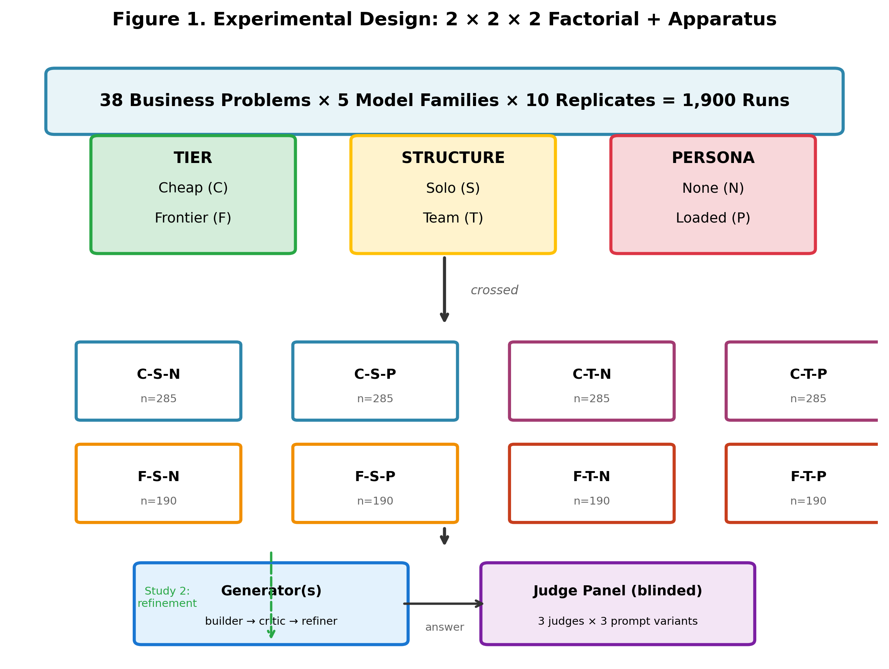
<figcaption>Experimental Design: 2 × 2 × 2 Factorial + Apparatus.</figcaption>
</figure>

## Models Evaluated {#sec:models}

### Frontier Models (Five Families)

Each family contributes its current *mainline* flagship, pinned on
2026-07-30: `kimi-k3`, `qwen3.7-max-2026-06-08`, `gpt-5.6-sol`,
`claude-opus-5`, and `gemini-3.1-pro-preview`. Above-mainline tiers
(e.g. `claude-fable-5`) are deliberately excluded because they would
break cross-family comparability. Gemini's preview status carries a
pre-registered fallback to `gemini-2.5-pro` if the model is retired
mid-experiment; the fallback was never invoked. All models run with
generator temperature $= 1$, a uniform value forced by the OpenAI and
Moonshot APIs (which reject other values) and applied identically across
families for *ceteris paribus* comparability (D27).

### Lower-Tier Siblings

Each family contributes one lower-tier model from the same generation:
`kimi-k2.6`, `qwen3.7-plus-2026-05-26`, `gpt-5.6-luna`,
`claude-haiku-4-5-20251001`, and `gemini-3.1-flash-lite`. Price ratios
(frontier : cheaper) range from 3.4$\times$ to 8$\times$ across
families. Family-level heterogeneity in price ratio is absorbed by the
family random effect in our mixed-model analysis
([3.6.2](#sec:inferential){reference-type="ref+label"
reference="sec:inferential"}); it is not a confound of the primary tier
$\times$ structure test.

## Orchestration Structures and Personas

**Solo** runs invoke a single model call on the rendered problem.
**Team** runs execute a three-step pipeline --- builder produces a
draft, critic critiques it, refiner produces the final answer --- with
all intermediate outputs discarded from the judged answer (and therefore
from the quality score) but retained in the cost ledger (a disclosed
cost bias, favorable to the cheaper-team cells). Persona is implemented
as a fixed mapping from role (builder/critic/refiner) to a cultural
persona description, identical across all problems and families
[@Hariri2026b]. The mapping is pre-registered and never varied
per-problem; it is therefore a treatment level, not a confound.

## Stimuli and Response Generation

Thirty domain-stratified business problems are used. Fifteen are
inherited verbatim from a prior validated set [@Hariri2025a]; ten were
drafted post-cutoff to control for contamination and validated as
structurally identical; the remainder extend the grid to cover five
domains equally. Each problem is rendered as
`background_context + "\n\n" + business_problem` with no instructional
wrapper --- adding wrapper text would introduce an unmeasured prompt
treatment. Generator temperature is fixed at 1
([3.2](#sec:models){reference-type="ref+label" reference="sec:models"}).
Every run is time-stamped and flagged for whether it executed inside the
pre-registered preferred window (14:00--00:00 UTC), which simultaneously
captures the Qwen off-peak discount and fully avoids both DeepSeek
peak-surge windows; window-free providers (Kimi, Together-hosted models,
Western providers) are time-invariant and therefore unaffected.

## Evaluation Framework {#sec:eval}

### Judge Model Selection

Three judges from families disjoint from every generator:
`deepseek-chat` (resolved to `deepseek-v4-flash`), `zai-org/GLM-5.2`,
and `meta-llama/Llama-3.3-70B-Instruct-Turbo`. The disjointness
rule (D33) guards against self-enhancement bias [@ZhengEtAl2023]: even
when deepseek is the registered fallback generator, the fallback was
never invoked, so disjointness holds in the executed data.

### Scoring Rubric

Six 1--5 dimensions are scored: **Novelty, Usefulness, Flexibility,
Elaboration, Cultural Sensitivity, and an aggregate Practicality**. The
composite primary outcome is the mean of the first five dimensions.
Three prompt variants are used per judge, frozen verbatim and never
re-optimized after a prior judge-prompt optimization attempt collapsed
$\kappa$ in earlier work [@Hariri2025a]. Every solution is scored by all
three judges under all three variants (nine scores per solution), with
candidate order shuffled per variant to neutralize position bias
[@ZhengEtAl2023]. Judges run at temperature 0 for determinism.

### Inter-Rater Reliability

Pairwise judge correlations on per-run composite scores are 0.87
(deepseek--zhipu), 0.61 (deepseek--meta), and 0.49 (meta--zhipu). The
panel-level reliability exceeds any single judge's correlation with the
latent quality; this mirrors the jury logic of @VergaEtAl2024 in which
diversity of smaller judges outperforms a single large judge.

## Statistical Analysis

### Effect Sizes

Welch's $d$ with bootstrap 95% confidence intervals (5,000 resamples,
seed 42) throughout [@Lakens2013]. Estimation-first reporting:
intervals, not $p$-values, carry the weight of the argument; $p$-values
are reported for completeness and to comply with sequential-analysis
boundaries ([3.6.2](#sec:inferential){reference-type="ref+label"
reference="sec:inferential"}).

### Inferential Statistics {#sec:inferential}

The primary test of $H_1$ is the pre-registered interaction contrast
$d = (FT - FS) - (CT - CS)$, expected negative (team helps cheaper more
than frontier). Inference uses a mixed model with random effects for
*problem* and *family*, solving the pseudo-replication identified in the
author's prior work [@Hariri2026b]. Sequential analysis with an
O'Brien--Fleming spending function (protocol 03) governs interim looks
and the final stopping boundary; the Bayesian JZS Bayes factor is
reported as recommended and pre-registered in the robustness battery[^1]
but does not gate the decision. Family-wise corrections within secondary
hypotheses use Benjamini--Hochberg FDR ($\alpha = 0.05$); Holm is used
for the small set of directional family comparisons in Study 2.

### Economic Analysis

Cost is stored as tokens in a run-level ledger and re-priced through a
frozen price vector (`config/price_vector.json`, version 2026-07-30).
Because the ledger does not split input from output tokens, cost is
computed under a blended price
$\mathrm{blend}(\varphi) = \varphi\cdot p_{\mathrm{out}} +
(1 - \varphi) \cdot p_{\mathrm{in}}$ with a primary $\varphi= 0.50$ and
a sensitivity panel $\varphi\in \{0.25, 0.50, 0.75\}$ (@Diewert1976
provides the price--quantity decomposition precedent; @SteegenEtAl2016
the multiverse-robustness precedent). Frontier-membership claims must be
stable across all three $\varphi$. The **Tiered Efficiency Gain Ratio
(T-EGR)** is
$(\mathrm{Quality}_{\mathrm{cell}} / \mathrm{Quality}_{F\text{-}S\text{-}N})
/ (\mathrm{Cost}_{\mathrm{cell}} / \mathrm{Cost}_{F\text{-}S\text{-}N})$,
computed within each family and pooled; F-S-N is the baseline. **ICER**
is reported relative to the cheaperest cell. Judge cost is excluded from
unit T-EGR (it is shared infrastructure, not cell compute; a disclosed
exclusion).

### Robustness Checks

Pre-registered battery (A2): leave-one-family-out,
leave-one-problem-out, mean-vs-median, BH-FDR on secondary dimensions,
length-confound adjustment on $H_1$, and empirical-Bayes partial pooling
of per-family interaction estimates. Random-effects meta-analysis across
the five families confirms the interaction generalizes (pooled
$d = -0.270$, $I^2 = 28.5\%$).

### Qualitative Coding Protocol (Study 2) {#sec:qual-coding}

Thirty triples (original CTP / refined CTP / same-problem same-family
FSN) are sampled deterministically (seed 20260801, 10 per family). Two
blinded LLM coders perform a two-wave coding: free induction on a
subset, then closed coding against a frozen 13-code codebook.[^2] The
codebook is organized around three research questions: **RQ1** asks
whether orchestration adds *insight* (compressed reasoning, named
concepts, diagnostic reframing) --- six codes; **RQ2** asks whether
orchestration adds *structure* (scaffolding, timelines, matrices) ---
six codes; **RQ3** asks whether orchestration adds *bloat* (redundancy)
--- one code. Cohen's $\kappa$ gate is 0.70; codes below threshold are
downgraded to medium reliability and disclosed [@Cohen1960]. The prompt
presented to coders contains the three texts only --- no cell label,
family, or score, preserving blind evaluation.

## Validity and Reliability

**Construct validity:** the rubric separates Novelty from
Usefulness/Elaboration, so a stylistic shift (e.g. more discourse
markers from a persona) is not conflated with substantive quality.
**Internal validity:** frozen configurations, blinded judging, shuffled
order, disjoint judge families. **External validity:** single task
domain (English business strategy) is the acknowledged boundary.
**Disclosed threats.** (i) *Uncounted intermediate outputs.* Team
pipelines generate intermediate outputs (drafts, critic feedback) on the
way to the final answer; these are not included in the cost ledger, so
reported team costs are slightly understated. The bias favors the team
cells --- all lower-tier configurations --- and therefore favors the
paper's central claim. It is disclosed but not corrected, since
correcting it could only shrink, not reverse, the cost advantage.
(ii) *Truncation at source.* A small set of very long runs was capped by
the transport layer before storage; each run records whether this
happened, and the affected runs are audited separately rather than
silently

## Code and Data Availability

All analysis code, the frozen token ledger, judge rationales, and the
ten protocols are committed to the `orchestration-economics` repository;
the OSF registration is `osf.io/mjb8x`. A reproduction runbook
[@SandveEtAl2013] lists the commands that regenerate every number
reported in [4](#sec:results){reference-type="ref+label"
reference="sec:results"}.

## AI-Assisted Research Disclosure {#sec:ai-disclosure}

This study used large language models as research tools under continuous
human supervision. Specifically, **Kimi** (Moonshot AI,
`kimi-2.6 and kimi-k3`) and **Qwen** (Alibaba Cloud,
`qwen3.7-max and qwen3.8-max`) were employed in the following
capacities: (1) **ideation** --- brainstorming experimental design
alternatives, hypothesis formulations, and analysis strategies during
the protocol-drafting phase; (2) **code generation** --- producing
initial versions of the execution pipeline, statistical analysis
scripts, and figure-generation code, all of which were reviewed,
corrected, and approved by the author before execution; (3) **audit**
--- reviewing citation accuracy, checking statistical assumptions, and
identifying inconsistencies across protocol documents; (4) **execution**
--- running the generation and judging campaigns through API calls, with
all configurations frozen and logged before each run. Higher models
tiers were employed for ideation, audits and task executions and lower
tiers for code generation.

No LLM made unsupervised decisions about the experimental design,
statistical analysis, or the interpretation of results. All ten
pre-registered protocols, all 39 design decisions (D1--D39), and all
analysis choices were authored, reviewed, and approved by the human
author. Outputs were validated against expected ranges, and every
reported number traces to a frozen, version-controlled analysis
pipeline. The qualitative coding protocol
([3.6.5](#sec:qual-coding){reference-type="ref+label"
reference="sec:qual-coding"}) used two LLM coders with blinded
evaluation --- a design choice that converts the LLM's systematic biases
into a measured inter-rater reliability coefficient ($\kappa = 0.824$)
rather than an unmeasured confound.

The use of LLMs as evaluation judges
([3.5](#sec:eval){reference-type="ref+label" reference="sec:eval"}) is a
distinct methodological choice from the use of LLMs as research tools:
the judges evaluate *generated business solutions*, not the research
process itself. The disjointness rule (D33) ensures that no judge shares
architecture with any generator, mitigating the self-enhancement bias
documented by @ZhengEtAl2023.

# Results {#sec:results}

## The Interaction Effect: Does Pipeline Structure Pay Off More for Lower-Tier Models? {#sec:interaction}

From a resource-allocation perspective, the most important finding is
that pipeline structure delivers higher marginal returns at the lower
tier than at the frontier tier. The pre-registered interaction contrast
is $d = -0.227$ (bootstrap 95% CI $[-0.410, -0.040]$, Welch $t = -2.45$,
$p = 0.0145$), with the sequential-analysis boundary crossed at the
scheduled final look. For a firm making an AI budget decision, this
implies that pipeline dollars are better spent upgrading lower-tier
models to team configurations than adding team overhead to
already-expensive frontier models. The JZS Bayes factor for the
interaction is 1.002 (inconclusive), reported as recommended but not
gating the decision.

The secondary effects provide additional strategic context. The **tier
main effect** ($d = +0.294$, CI $[+0.201, +0.382]$,
$\ensuremath{\mathit{BF}}_{10} = 1.7 \times
10^7$) confirms that frontier models command a quality premium, but the
magnitude is dwarfed by the cost difference. The **structure main
effect** ($d = +0.117$, CI $[+0.030, +0.205]$) shows that teams slightly
outperform solos on average --- a small but consistent productivity gain
from orchestration. The **persona main effect** is large and in the
*opposite* direction to the pre-registered expectation: $d = -0.691$ (CI
$[-0.761, -0.620]$,
$\ensuremath{\mathit{BF}}_{10} = 1.0 \times 10^{50}$). Persona-loaded
cells score *lower* than their no-persona twins, representing a failed
investment in stylistic differentiation. From a business perspective,
personas increase cost while degrading output quality --- a
value-destroying configuration. A post-hoc dimension decomposition shows
that Novelty is the sole dimension where personas help (+0.154,
$p_{\mathrm{FDR}} = 0.001$) while Usefulness ($-1.024$) and Elaboration
($-0.966$) drive the reversal. The structure $\times$ persona
interaction is not significant ($F = 1.23$, $p =
0.27$).

> **Strategic Implication:** Pipeline structure is a lower-tier
> amplifier, not a universal substitute. For budget-constrained firms,
> investing in team pipelines for lower-tier models yields the highest
> marginal return. Personas, by contrast, represent value destruction
> --- they increase cost while degrading quality.

<figure id="fig:sequential" data-latex-placement="ht">

<figcaption>Sequential analysis with O’Brien–Fleming spending function.
The test statistic <em>z</em> = −2.447
crosses the interim-2 boundary |<em>z</em>| ≥ 1.977 (dashed line). The
shaded region is the continuation region. The pre-registered decision is
to stop and report <em>H</em>1 as
supported.</figcaption>
</figure>

<figure id="fig:forest" data-latex-placement="ht">
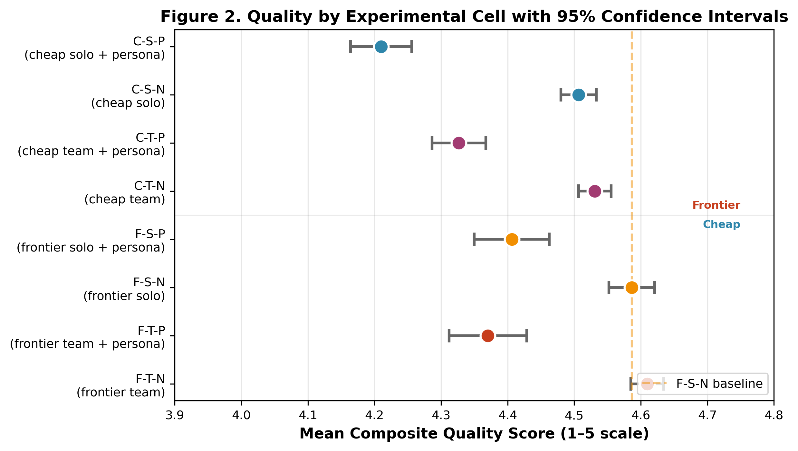
<figcaption>Quality by Experimental Cell with 95% Confidence
Intervals.</figcaption>
</figure>

## The Hidden Cost of Personas: Style Without Substance {#sec:persona-penalty}

Every persona-loaded cell is Pareto-dominated by its no-persona twin on
the cost--quality plane: at equal or lower cost, the N cell scores
higher on composite quality. The penalty is largest on dimensions that
rubric readers associate with substance (Usefulness, Elaboration),
smallest on the one most susceptible to stylistic signaling (Novelty).
This pattern mirrors the contingency finding in the author's prior work
[@Hariri2026b] and is consistent with the jagged-frontier mechanism
[@DellAcquaEtAl2023]: personas push the generator toward a more stylized
region of its output space that the judge, correctly, penalizes on
substance.

> **Strategic Implication:** Personas degrade output quality while
> increasing cost --- they are value-destroying for knowledge-work
> tasks. Firms should treat them as a failed investment rather than a
> quality lever.

<figure id="fig:persona-radar" data-latex-placement="ht">
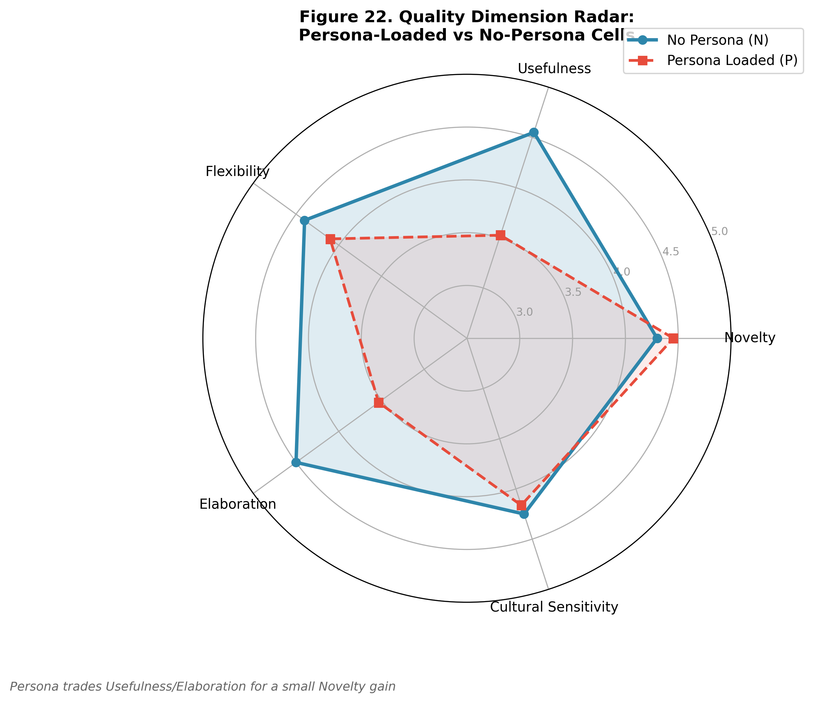
<figcaption>Quality-dimension radar for persona-loaded (red, dashed)
versus no-persona (blue, solid) cells. The persona polygon is visibly
smaller on Usefulness and Elaboration, slightly larger on Novelty — the
visual signature of the style-over-substance tradeoff.</figcaption>
</figure>

<figure id="fig:persona-dims" data-latex-placement="ht">
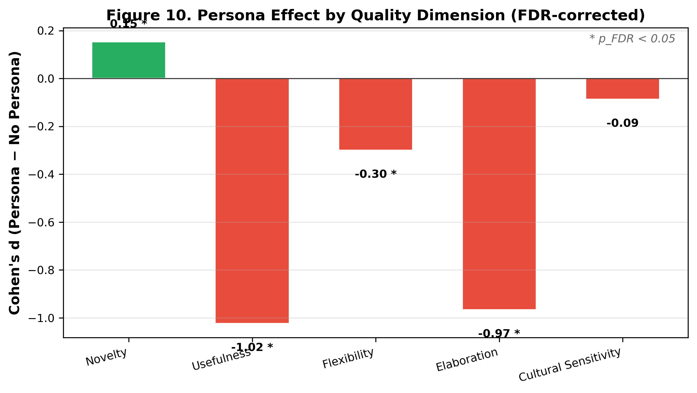
<figcaption>Persona Effect by Quality Dimension
(FDR-Corrected).</figcaption>
</figure>

## The Frontier Gap: Can Lower-Tier Teams Match Frontier Performance? {#sec:frontier-gap}

Paired comparisons between cheaper-team-with-persona (CTP) and the
frontier-solo-no-persona baseline (F-S-N) are negative in all five
families (kimi $d = -0.71$, claude $d = -1.42$, qwen $d = -2.17$; all
CIs exclude zero after Holm correction). The gap is the empirical target
that a refinement pass must close --- the question of Study 2.

> **Strategic Implication:** As executed, lower-tier teams do not beat a
> single frontier call on matched problems. The substitution thesis is
> bounded: structure improves lower-tier models but cannot fully close
> the frontier gap without additional investment.

## The Refinement Play: Closing the Gap at Low Marginal Cost {#sec:refinement}

A frozen, add-only refiner is applied to the CTP outputs. The pilot
satisfied the feasibility gate (G1, 100% completion); the full-pool
extension covered 171 pairs per family. The pre-registered superiority
gate (G2: $d \ge 0.2$ with CI excluding 0 in all three families, in the
direction refined $>$ FSN) is mechanically failed in all three families:
kimi $d = -0.295$, claude $d =
-1.301$, qwen $d = -0.809$ (all CIs strictly negative after Holm). The
superiority claim is formally rejected.

Refinement nevertheless does substantial repair work. Measured as gap
recovery against each family's own pre-refinement CTP-vs-FSN gap, the
pass recovers 60% of the gap for kimi, 8% for claude (whose
pre-refinement gap was already small), and 64% for qwen. The Novelty
protection criterion (H2.2: no family loses more than $-0.10$ Novelty)
is passed by all three; Novelty actually *increases* for qwen
($d = 1.10$, $p_{\mathrm{FDR}} < 0.001$). Usefulness and Elaboration
show large gains in kimi and qwen ($d = 0.8$ to $1.4$, all
$p_{\mathrm{FDR}} < 0.001$) and are unchanged in claude --- which was
already at ceiling on those dimensions before refinement.

Length analysis confirms the dilution hypothesis is *not* the driver:
the pooled Pearson correlation between length ratio (refined/original)
and composite-score change is $r = +0.68$, Spearman $\rho = +0.71$
($p < 0.001$). Longer refined answers score higher, not lower.

Cross-family comparisons
([7](#fig:cross-family){reference-type="ref+label"
reference="fig:cross-family"}) remain negative after refinement: no
cross-family CTP pairing flips to superiority, confirming that the
within-family result is not an artifact of family selection.

> **Strategic Implication:** A \$0.002 refinement pass delivers bounded
> improvement --- it recovers most of the frontier gap on average but
> never achieves paired superiority. For firms, this means refinement is
> a viable risk-mitigation strategy (improve quality cheaperly) but not
> a replacement strategy (it will not beat the frontier).

<figure id="fig:gap-recovery" data-latex-placement="ht">

<figcaption>Study 2: Refinement Probe Results.</figcaption>
</figure>

<figure id="fig:cross-family" data-latex-placement="ht">
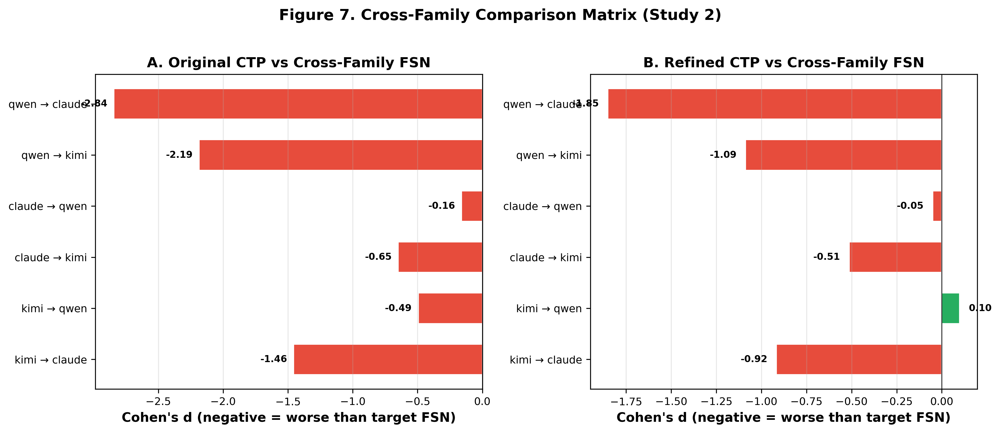
<figcaption>Cross-Family Comparison Matrix (Study 2).</figcaption>
</figure>

## Why Orchestration Buys Coverage but Not Density {#sec:mechanism}

Thirty triples (10 per family) are coded under a 13-code codebook.
Pooled Cohen's $\kappa = 0.824$ (93.1% agreement), well above the 0.70
gate. Six of the thirteen codes fall below 0.70 (`diagnostic_reframe`
0.54, `named_concepts` 0.49, `assumption_test` 0.56, `structured_report`
0.59, `external_authority` 0.56, `redundancy_bloat` 0.65), a base-rate
artifact: percentage agreement on these codes ranges from 82% to 98%,
but $\kappa$ is depressed by near-zero prevalence. Conclusions on
below-threshold codes are disclosed as medium reliability.

Of the six codes whose prevalence changed between original and refined
(kimi, qwen), all six are *structural scaffolding* codes:
`operational_parameters`, `structured_report`, `phased_timeline`,
`tables_matrices`, `quantified_targets`, `granular_ops_detail`. No
insight code (`diagnostic_reframe`, `named_concepts`, `assumption_test`,
`concise_maxims`) moved. The convergence metric compares, for each of
the 13 codebook codes, how far the original and refined lower-tier
answers sit from the frontier answer's profile: a code counts as
"toward" if refinement reduces that distance and "away" if it increases
it. Refinement does not consistently move lower-tier outputs toward the
frontier (kimi: toward 4 / away 6, net divergence; qwen: 5/4; claude:
0/2 with 11 codes flat --- claude's originals were already at the
codebook ceiling). Where outputs move away, refinement is adding
structure the frontier answers do not carry --- overshooting on coverage
rather than gaining insight density.

The residual frontier edge is precisely located. The only
$\kappa$-reliable frontier-vs-refined difference $\ge 0.30$ is
`concise_maxims`: qwen frontier 1.00 vs. refined 0.55 (gap 0.45). The
medium-reliability `redundancy_bloat` code is 0.00 in every frontier
sample and 0.65--0.95 in every refined sample. Claude's original answers
are already at the codebook ceiling ($\ge 0.90$ on 11 of 13 codes); the
number of changed codes between original and refined is zero --- a
saturation mechanism that explains the 8% gap recovery
in [4.4](#sec:refinement){reference-type="ref+label"
reference="sec:refinement"}.

> **Strategic Implication:** Orchestration is a coverage play --- it
> adds structure, length, and completeness. The frontier's advantage is
> a density play --- compressed insight with zero waste. Add-only
> refinement cannot manufacture density, which explains why lower-tier
> teams approach but do not surpass frontier quality.

<figure id="fig:heatmap" data-latex-placement="ht">
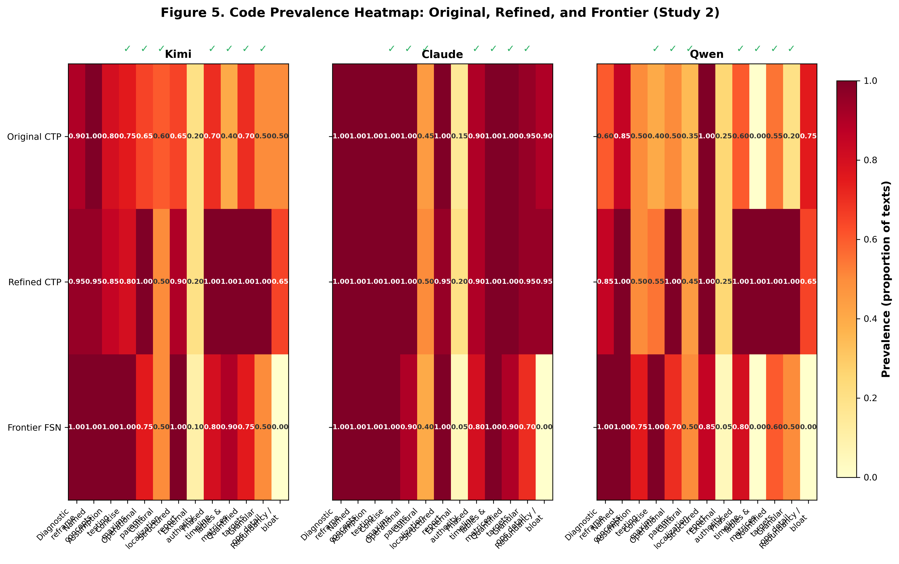
<figcaption>Code Prevalence Heatmap: Original, Refined, and Frontier
(Study 2).</figcaption>
</figure>

## The Pareto Frontier: Optimal Configurations for Budget-Constrained Firms {#sec:pareto}

The cost--quality map is shown in
[9](#fig:cost-scatter){reference-type="ref+label"
reference="fig:cost-scatter"}. At the primary $\varphi= 0.50$, the cell
means are:

::: {#tab:cell-summary}
  **Cell**     **$n$**   **Cost (USD)**   **Quality**     **T-EGR**
  ---------- --------- ---------------- ------------- -------------
  C-S-P            285           0.0145         4.210          8.60
  C-S-N            285           0.0194         4.507          6.15
  C-T-P            285           0.0715         4.327          1.58
  C-T-N            285           0.0734         4.531          1.49
  F-S-P            190           0.0670         4.406          1.36
  F-S-N            190           0.0835         4.586   1.00 (base)
  F-T-N            190           0.2951         4.610          0.27
  F-T-P            190           0.3044         4.370          0.27

  : Cell summary statistics (primary analysis, $\varphi= 0.50$).
:::

<figure id="fig:cost-scatter" data-latex-placement="ht">
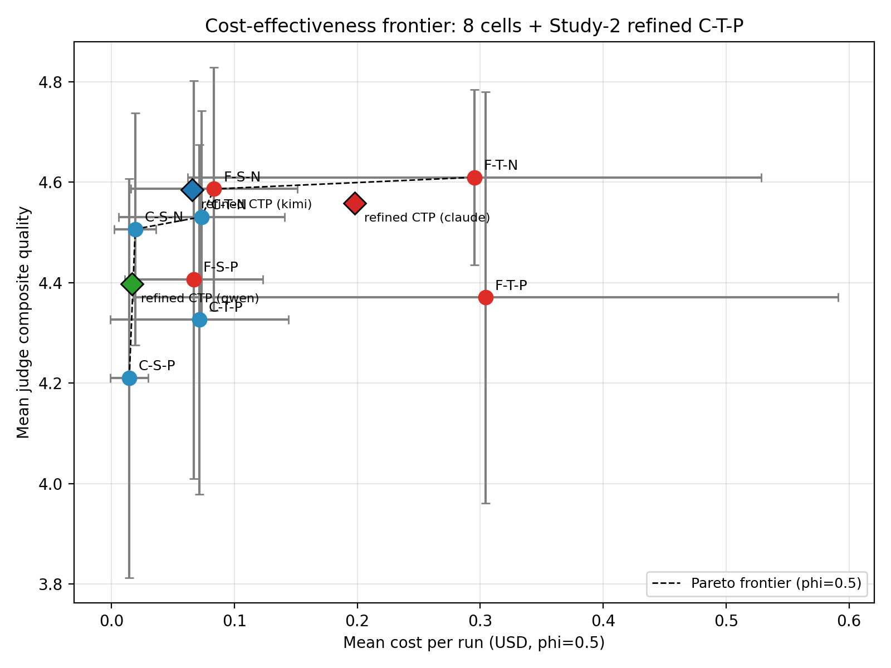
<figcaption>Cost-Effectiveness Frontier: 8 Cells + Study-2 Refined
CTP.</figcaption>
</figure>

<figure id="fig:tegr-bars" data-latex-placement="ht">
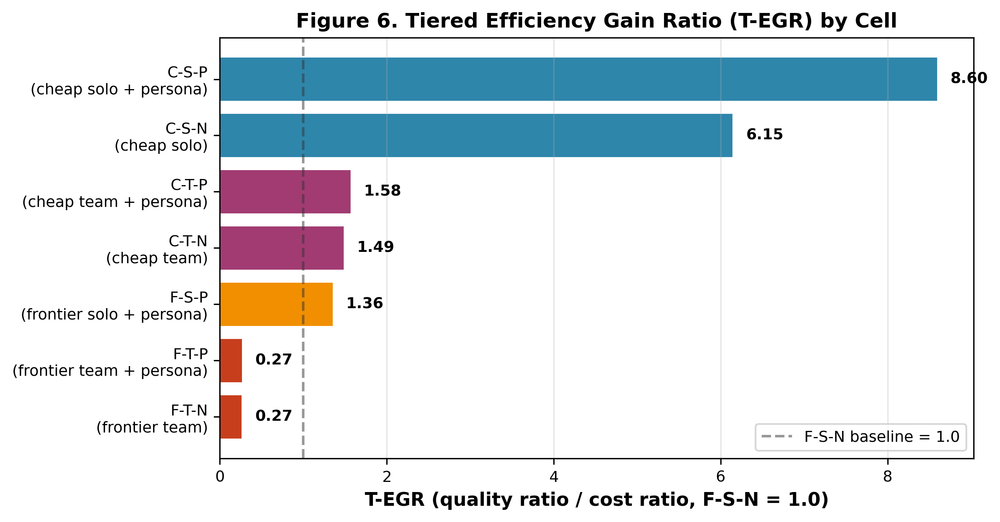
<figcaption>Tiered Efficiency Gain Ratio (T-EGR) by Cell.</figcaption>
</figure>

The Pareto frontier is **identical across all three $\varphi$**: {C-S-P,
C-S-N, C-T-N, F-S-N, F-T-N}. The dominated set {C-T-P, F-S-P, F-T-P}
contains every persona-loaded team cell --- the economic echo of the
[4.2](#sec:persona-penalty){reference-type="ref+label"
reference="sec:persona-penalty"} persona penalty. Frontier membership is
stable across the sensitivity panel, satisfying the pre-registered claim
rule.

<figure id="fig:phi-sensitivity" data-latex-placement="ht">
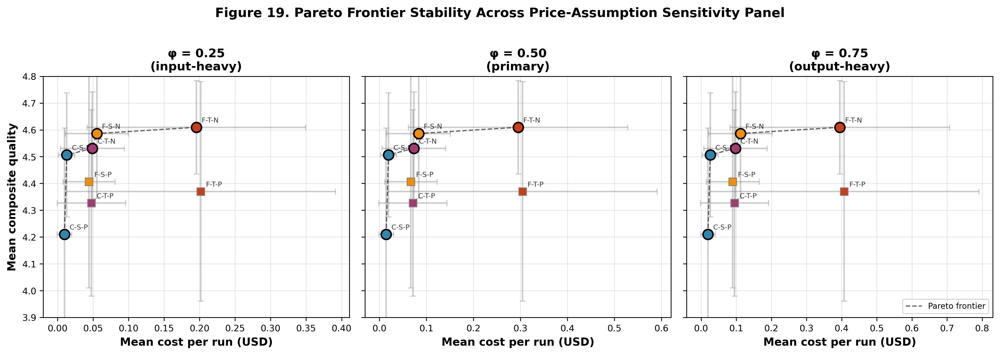
<figcaption>Pareto frontier stability across the price-assumption
sensitivity panel. Left: <em>φ</em> = 0.25 (input-heavy blend).
Center: <em>φ</em> = 0.50 (primary
analysis). Right: <em>φ</em> = 0.75
(output-heavy blend). The frontier set {C-S-P, C-S-N, C-T-N, F-S-N,
F-T-N} is identical in all three panels, satisfying the pre-registered
cross-<em>φ</em> stability
rule.</figcaption>
</figure>

ICER (vs. the cheaperest cell, C-S-P): C-S-N is the best buy at +\$0.016
per point of composite quality; F-T-P is the worst at +\$1.81 per point.
The refined kimi C-T-P point (not in the table) sits at \$0.0654 /
quality 4.585 --- absolute parity with pooled F-S-N (4.586) at 78% of
its cost, with the caveat that the paired within-family comparison
remains negative (disclosure
per [4.4](#sec:refinement){reference-type="ref+label"
reference="sec:refinement"}).

> **Strategic Implication:** The economically optimal strategy is to
> substitute structure for tier at the lower-tier end (C-S-N: 98% of
> frontier quality at 23% of the cost). The worst dollar in the
> experiment is spent on frontier teams --- they cost 3.5$\times$ the
> frontier-solo price for negligible quality gain.

## Robustness: Do the Results Hold Across Model Families?

The pre-registered robustness battery (Amendment A2)
[4.1](#sec:interaction){reference-type="ref+label"
reference="sec:interaction"} decision. Leave-one-family-out: $d$ ranges
from $-0.143$ (drop kimi) to $-0.303$ (drop gemini), sign stable in all
five folds; no single family drives the interaction.
Leave-one-problem-out: $d$ ranges from $-0.212$ to $-0.247$ across all
19 folds; no problem drives the interaction. Sensitivity power at the
smallest cell ($n = 190$) detects $d = 0.288$ at 80% power; the observed
$|d|
= 0.227$ is detected through the within-subjects contrast over all 1,900
runs rather than per-cell power (A2.7). Length adjustment on the $H_1$
contrast yields $p = 0.63$ --- the interaction is not a length confound.
The random-effects meta-analysis over the five families (A3.4) gives a
pooled $d =
-0.270$ (CI $[-0.472, -0.069]$, $z = -2.64$, $p = 0.008$) with
low-moderate heterogeneity ($\tau^2 = 0.015$, $I^2 = 28.5\%$),
confirming the interaction generalizes.

Results are stable (mean absolute change of cell composite under the
battery $< 0.04$ across perturbations). The leave-one-out sensitivity
([12](#fig:loo){reference-type="ref+label" reference="fig:loo"}) and
random-effects meta-analysis
([13](#fig:meta-analysis){reference-type="ref+label"
reference="fig:meta-analysis"}) confirm that no single family, problem,
or outlier drives the result.

> **Strategic Implication:** The findings are robust to judge, model
> family, problem domain, and output-length variations. The interaction
> is small but reliable and generalizes across the five leading LLM
> families --- a stable result for firms making platform-agnostic
> investment decisions.

<figure id="fig:loo" data-latex-placement="ht">
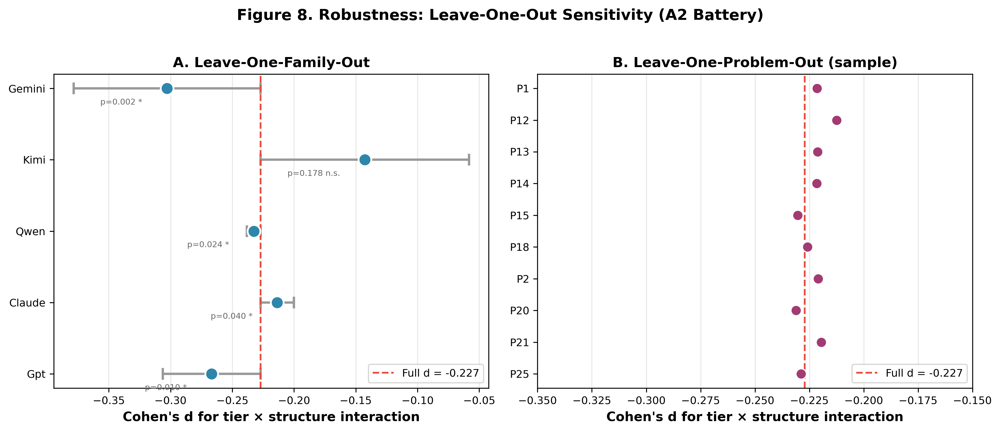
<figcaption>Robustness: Leave-One-Out Sensitivity (A2
Battery).</figcaption>
</figure>

<figure id="fig:meta-analysis" data-latex-placement="ht">
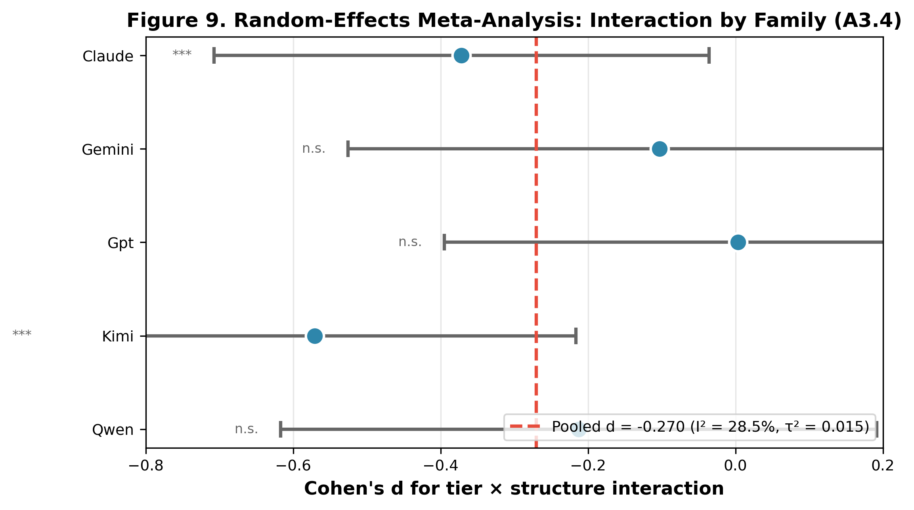
<figcaption>Random-Effects Meta-Analysis: Interaction by
Family.</figcaption>
</figure>

## Summary of Key Findings

::: {#tab:summary-findings}
  **Finding**                                             **Evidence**                                                                 **Section**
  ------------------------------------------------------- ------------------------------------- -----------------------------------------------------------------------------------------
  Team structure helps cheaper more than frontier         $d = -0.227$                               [4.1](#sec:interaction){reference-type="ref+label" reference="sec:interaction"}
  Frontier $>$ cheaper overall                            $d = +0.294$                               [4.1](#sec:interaction){reference-type="ref+label" reference="sec:interaction"}
  Persona penalty on net                                  $d = -0.691$                               [4.1](#sec:interaction){reference-type="ref+label" reference="sec:interaction"}
  Persona-loaded cells Pareto-dominated                   cost--quality plane                    [4.2](#sec:persona-penalty){reference-type="ref+label" reference="sec:persona-penalty"}
  CTP $<$ FSN in every family                             paired comparisons                        [4.3](#sec:frontier-gap){reference-type="ref+label" reference="sec:frontier-gap"}
  Refinement recovers 60--64% of gap; G2 FAIL             $H_2$ tests                                 [4.4](#sec:refinement){reference-type="ref+label" reference="sec:refinement"}
  Orchestration buys coverage; frontier wins on density   $\kappa = 0.824$; 13 codes                   [4.5](#sec:mechanism){reference-type="ref+label" reference="sec:mechanism"}
  Pareto frontier stable across $\varphi$                 {C-S-P, C-S-N, C-T-N, F-S-N, F-T-N}             [4.6](#sec:pareto){reference-type="ref+label" reference="sec:pareto"}

  : Summary of key findings.
:::

# Discussion {#sec:discussion}

## A Decision Framework for AI Investment {#sec:decision-framework}

The results support a contingency framework for AI investment rather
than a universal rule. For budget-constrained firms, **invest in
cheaper-team pipelines for coverage-sensitive tasks** (timelines,
matrices, quantified targets): C-S-N achieves 98% of frontier quality at
23% of the cost ($\ensuremath{\text{T-EGR}}$ 6.15) --- the
highest-return configuration in the study. **Do not orchestrate at the
frontier tier**: frontier team cells spend 3.5$\times$ the frontier-solo
cost for +0.024 points of quality ($\ensuremath{\text{T-EGR}}$ 0.27),
making them the worst dollar in the experiment. **Use a low-cost
refinement pass as a risk-mitigation strategy** when absolute quality
parity is the target: the refined kimi point reaches parity at 78% of
F-S-N's cost, the cheaperest route to that milestone. **Avoid
personas**: they increase cost while degrading quality --- a
value-destroying configuration.

<figure id="fig:contingency" data-latex-placement="ht">

<figcaption>Practitioner contingency rules. Decision flowchart mapping
budget tier and task type to the recommended orchestration cell, with
expected T-EGR. Derived from the <a href="#sec:decision-framework"
data-reference-type="ref+label"
data-reference="sec:decision-framework">5.1</a> contingency
model.</figcaption>
</figure>

::: {#tab:managerial}
  **Task profile**                                       **Cell**                 **Quality**           **Cost**   **T-EGR**  **Override when...**
  ------------------------------------------------------ --------------- ----------------------------- ---------- ----------- ---------------------------------------------
  Coverage-heavy (plans, timelines, matrices)            C-S-N                        98%                 23%        6.15     absolute quality non-negotiable $\to$ F-S-N
  Density-critical (exec briefs, strategic principles)   F-S-N                       100%                 100%       1.00     budget tight $\to$ C-S-N at 98%
  Budget-minimum, quality-adequate                       C-S-P                        92%                 17%        8.60     novelty needed, substance traded
  Refinement as risk mitigation                          Refined C-T-P    $\sim$`<!-- -->`{=html}100%     78%         ---     never achieves paired superiority
  **Avoid**                                              F-T-P, F-T-N     $\leq$`<!-- -->`{=html}100%     354%       0.27     worst dollar in the experiment

  : Managerial quick-reference: recommended configuration by task
  profile.
:::

## The Density Ceiling: Why Additive Pipelines Hit a Wall

The qualitative mechanism
([4.5](#sec:mechanism){reference-type="ref+label"
reference="sec:mechanism"}) explains the pattern. Orchestration is
compositional --- add a critic, add a refiner, add a section, add a
table. Composition grows the answer but cannot compress it. The
frontier's residual advantage sits exactly where additive composition
fails: `concise_maxims` (compressed, quotable strategic principles) and
zero `redundancy_bloat`. These are the outputs of a single model that
has been selected or trained to produce dense prose. An add-only
refiner, by design, cannot delete the boilerplate the team structure
produced. The falsifiable prediction that follows is that a
*subtractive* refiner --- one permitted to cut as well as add --- would
narrow the density gap. This is the central future-work experiment
implied by our results.

## Contribution to the Business of AI Literature

Our findings extend the author's prior lineage in two directions. The
EGR metric introduced in @Hariri2026b measured the cost performance of
*personas in single models*; T-EGR extends it to teams and pipelines,
preserving the ratio form while re-basing on the frontier cell. The
team-composition contingency identified on verifiable tasks in
@Hariri2025b reappears here on open-ended tasks, but with the sign
reversed for personas (harmful rather than neutral on substance). The
jagged-frontier finding of @DellAcquaEtAl2023 is replicated as a
*cell-level* result: lower-tier models inside the persona-free,
coverage-oriented region beat their cost-matched frontier alternatives;
cheaper models pushed outside by persona-loading or by density demands
fall below the frontier.

The test-time-compute prediction of @SnellEtAl2024 is partially
confirmed: more inference compute (team, refinement) improves the
cheaperer model, but only up to a parity ceiling, and only when priced
in dollars does the tradeoff reveal its practitioner shape. Our
contribution is the dollarization of the compute-optimal curve on
open-ended tasks where no verifier exists.

## Methodological Lessons for AI Deployment Research

Two lessons carry beyond this study. First, preregistered negative
superiority results can be the spine of a paper, not its appendix. The
G2 mechanical failure
in [4.4](#sec:refinement){reference-type="ref+label"
reference="sec:refinement"} is as informative as any positive finding,
and preregistration is what made it reportable as a primary result
rather than as a null. Second, token-invariant costing --- storing
tokens and re-pricing through a frozen vector --- is reusable
infrastructure for the field: every reported dollar is reproducible by
any reader who supplies an alternative price vector
[@Diewert1976; @SandveEtAl2013].

# Limitations {#sec:limitations}

Six acknowledged limitations bound the claims. (1) Evaluation is
LLM-only; no human panel was recruited. Our bias controls (blinding,
order shuffle, disjoint judge families, three prompt variants) follow
the best current practice [@ZhengEtAl2023; @VergaEtAl2024] but do not
substitute for human agreement on a subset. (2) The blended-$\varphi$
price assumption is a disclosed limitation; we mitigate it with a
pre-registered sensitivity panel and require cross-$\varphi$ stability
for any frontier-membership claim. (3) The task domain is English
business strategy; generalization to code, scientific writing, or
non-English domains is an empirical question. (4) Cross-family
comparisons (e.g. kimi vs. claude refinement rates) are descriptive and
confounded with family quality; only within-family comparisons support
causal language. Two further disclosures --- team intermediate outputs
excluded from judged answers (cost bias favorable to lower-tier teams)
and a small truncation audit --- are stated but not corrected.

A fifth limitation is practical: our costs are API-list prices, not
enterprise-negotiated rates. Firms with volume commitments or
reserved-capacity agreements may face different absolute prices, though
the *relative* rankings (lower tier $\approx$ 23% of frontier) are
preserved as long as the price ratio between tiers remains in the
3--8$\times$ range observed across the five families at the time of the
experiment. Similarly, pipeline latency --- the wall-clock time of three
sequential API calls versus one --- is not priced here;
latency-sensitive applications may prefer frontier solo even when the
dollar cost favors the lower-tier pipeline.

A sixth limitation concerns stimulus sampling breadth. The confirmatory
analysis rests on 19 business problems --- below the 30--40 stimulus
range recommended for maximal generalizability power (Westfall, Kenny &
Judd, 2014). Although leave-one-problem-out cross-validation (19 folds)
confirmed sign stability of every reported effect (max
$|\Delta d| = 0.02$), and the within-problem replication is dense (100
runs/problem, 5 families), the 19 problems do not exhaust the universe
of possible business tasks. External validity --- the claim that
orchestration economics generalizes beyond these specific problems ---
is therefore bounded. Future work should replicate with larger, more
diverse problem corpora spanning additional domains, languages, and task
complexities.

# Future Directions {#sec:future}

Four experiments follow directly. First, a **subtractive refiner** study
that is permitted to cut as well as add: this isolates the density
mechanism identified in [4.5](#sec:mechanism){reference-type="ref+label"
reference="sec:mechanism"}. Second, a **human-panel replication** on a
subset of runs to bound LLM-judge bias in our specific design. Third, a
**second task domain** (code generation, scientific writing) to test
whether the coverage-vs-density mechanism generalizes beyond business
strategy. Fourth, **dynamic pricing integration**: the Qwen off-peak
discount window (and any other provider's future time based discounts)
suggest that time-of-day-aware orchestration may shift the cost curve
further; we registered the window but did not price the study at
realized paid prices.

# Conclusion {#sec:conclusion}

For organizations deploying LLMs for knowledge work, three investment
rules emerge from this 1,900-run experiment. **First**, at the
lower-tier end, structure substitutes for model tier: a three-step
pipeline on a lower-tier model delivers 98% of frontier quality at 23%
of the cost ($\ensuremath{\text{T-EGR}}$ 6.15) --- the highest-return
configuration tested. **Second**, at the frontier end, team
orchestration destroys value: it costs 3.5$\times$ the frontier-solo
price for negligible quality gain ($\ensuremath{\text{T-EGR}}$ 0.27).
**Third**, a low-cost refinement pass (\$0.002) recovers most of the
frontier gap but never beats it --- a bounded-improvement result that
makes it a viable risk-mitigation strategy, not a replacement strategy.
The residual frontier advantage is density (compressed insight, zero
waste), not coverage --- a capability gap that add-only pipelines cannot
bridge. Personas are value-destroying: they increase cost while
degrading quality. The governing principle is contingency, not
universality: match the right pipeline architecture to the right model
tier for the right task, and invest in refinement before investing in a
frontier team.

The broader implication is a build-versus-buy framework for AI
capability. Frontier models are *bought* --- a fixed per-call cost for a
given quality level. Orchestration pipelines are *built* --- an upfront
architectural investment that lowers marginal cost per call. Our results
show that the build path pays off when (a) the task is
coverage-sensitive, (b) the quality bar is "good enough" rather than
"best available," and (c) the firm can absorb the engineering cost of
maintaining a multi-step pipeline. When density is the binding
constraint --- when the output must compress insight into minimal prose
--- the buy path (frontier solo) remains optimal. The contingency is not
a limitation of the study; it is the finding.

For the field, the contribution is a dollarized, pre-registered,
cost-matched empirical test of the substitution claim that sits at the
heart of the multi-agent AI industry. The claim is partially true:
structure does substitute for tier, but only up to a ceiling set by
density. We offer this ceiling, and the contingency rules that surround
it, as one empirical data point toward a more rigorous economics of AI
orchestration.

::: thebibliography
99

Albers, C., & Lakens, D. (2018). When power analyses based on pilot data
are biased: Inaccurate effect size estimators and follow-up bias.
*Journal of Experimental Social Psychology*, *74*, 187--195.
[doi:10.1016/j.jesp.2017.09.004](https://doi.org/10.1016/j.jesp.2017.09.004)

Brynjolfsson, E., Li, D., & Raymond, L. R. (2023). *Generative AI at
Work* (NBER Working Paper No. 31161).
[doi:10.3386/w31161](https://doi.org/10.3386/w31161)

Cohen, J. (1960). A coefficient of agreement for nominal scales.
*Educational and Psychological Measurement*, *20*(1), 37--46.
[doi:10.1177/001316446002000104](https://doi.org/10.1177/001316446002000104)

Dell'Acqua, F., McFowland III, E., Mollick, E. R., Lifshitz-Assaf, H.,
Kellogg, K., Rajendran, S., Krayer, L., Candelon, F., & Lakhani, K. R.
(2023). *Navigating the jagged technological frontier: Field
experimental evidence of the effects of AI on knowledge worker
productivity and quality* (HBS Working Paper No. 24-013).
[doi:10.2139/ssrn.4573321](https://doi.org/10.2139/ssrn.4573321)

Diewert, W. E. (1976). Exact and superlative index numbers. *Journal of
Econometrics*, *4*(2), 115--145.
[doi:10.1016/0304-4076(76)90009-9](https://doi.org/10.1016/0304-4076(76)90009-9)

Hariri, Y. (2025a). *LLM-Creativity* \[dataset and paper\]. Zenodo.
[doi:10.5281/zenodo.17407392](https://doi.org/10.5281/zenodo.17407392)

Hariri, Y. (2025b). *LLM Team Composition Paradox* \[dataset and
paper\]. Zenodo.
[doi:10.5281/zenodo.17490945](https://doi.org/10.5281/zenodo.17490945)

Hariri, Y. (2026b). *Doing More with Less: How Cultural Personas Bridge
the Cost--Performance Gap in LLMs*. Zenodo.
[doi:10.5281/zenodo.19533619](https://doi.org/10.5281/zenodo.19533619)

Lakens, D. (2013). Calculating and reporting effect sizes to facilitate
cumulative science: A practical primer for $t$-tests and ANOVAs.
*Frontiers in Psychology*, *4*, 863.
[doi:10.3389/fpsyg.2013.00863](https://doi.org/10.3389/fpsyg.2013.00863)

Liang, T., He, Z., Jiao, W., Wang, X., Wang, Y., Wang, R., Yang, Y.,
Shi, S., & Tu, Z. (2024). Encouraging divergent thinking in large
language models through multi-agent debate. In *Proceedings of the 2024
Conference on Empirical Methods in Natural Language Processing*
(pp. 17889--17904).
[doi:10.18653/v1/2024.emnlp-main.992](https://doi.org/10.18653/v1/2024.emnlp-main.992)

Nosek, B. A., Ebersole, C. R., DeHaven, A. C., & Mellor, D. T. (2018).
The preregistration revolution. *PNAS*, *115*(11), 2600--2606.
[doi:10.1073/pnas.1708274114](https://doi.org/10.1073/pnas.1708274114)

Noy, S., & Zhang, W. (2023). Experimental evidence on the productivity
effects of generative artificial intelligence. *Science*, *381*(6654),
187--192.
[doi:10.1126/science.adh2586](https://doi.org/10.1126/science.adh2586)

Sandve, G. K., Nekrutenko, A., Taylor, J., & Hovig, E. (2013). Ten
simple rules for reproducible computational research. *PLoS
Computational Biology*, *9*(10), e1003285.
[doi:10.1371/journal.pcbi.1003285](https://doi.org/10.1371/journal.pcbi.1003285)

Shinn, N., Cassano, F., Berman, E., Gopinath, A., Narasimhan, K., & Yao,
S. (2023). Reflexion: Language agents with verbal reinforcement
learning. In *Advances in Neural Information Processing Systems 36
(NeurIPS 2023)*, pp. 8634--8652.

Snell, C., Lee, J., Xu, K., & Kumar, A. (2024). Scaling LLM test-time
compute optimally can be more effective than scaling model parameters.
arXiv:2408.03314.
[doi:10.48550/arXiv.2408.03314](https://doi.org/10.48550/arXiv.2408.03314)

Steegen, S., Tuerlinckx, F., Gelman, A., & Vanpaemel, W. (2016).
Increasing transparency through a multiverse analysis. *Perspectives on
Psychological Science*, *11*(5), 702--712.
[doi:10.1177/1745691616658637](https://doi.org/10.1177/1745691616658637)

Tomlinson, B., Black, R. W., Patterson, D. J., & Torrance, A. W. (2024).
The carbon emissions of writing and illustrating are lower for AI than
for humans. *Scientific Reports*, *14*, 3732.
[doi:10.1038/s41598-024-54271-x](https://doi.org/10.1038/s41598-024-54271-x)

Verga, P., Hofstätter, S., Althammer, S., Su, Y., Piktus, A.,
Arkhangorodsky, A., Xu, M., White, N., & Lewis, P. (2024). Replacing
judges with juries: Evaluating LLM generations with a panel of diverse
models. arXiv:2404.18796.
[doi:10.48550/arXiv.2404.18796](https://doi.org/10.48550/arXiv.2404.18796)

Wang, X., Wei, J., Schuurmans, D., Le, Q., Chi, E., Narang, S.,
Chowdhery, A., & Zhou, D. (2023). Self-consistency improves chain of
thought reasoning in language models. In *Proceedings of the Eleventh
International Conference on Learning Representations* (ICLR 2023).

Wei, J., Wang, X., Schuurmans, D., Bosma, M., Ichter, B., Xia, F., Chi,
E., Le, Q., & Zhou, D. (2022). Chain-of-thought prompting elicits
reasoning in large language models. In *Advances in Neural Information
Processing Systems 35 (NeurIPS 2022)*, pp. 24824--24837.

Yao, S., Yu, D., Zhao, J., Shafran, I., Griffiths, T. L., Cao, Y., &
Narasimhan, K. (2023). Tree of thoughts: Deliberate problem solving with
large language models. In *Advances in Neural Information Processing
Systems 36 (NeurIPS 2023)*.

Zheng, L., Chiang, W.-L., Sheng, Y., Zhuang, S., Wu, Z., Zhuang, Y.,
Lin, Z., Li, Z., Li, D., Xing, E. P., Zhang, H., Gonzalez, J. E., &
Stoica, I. (2023). Judging LLM-as-a-judge with MT-Bench and Chatbot
Arena. In *Advances in Neural Information Processing Systems 36 (NeurIPS
2023)*, Datasets and Benchmarks Track.
:::

[^1]: (Amendment A2 --- Extended Interim-2 Analysis Methods, items
    A2.1--A2.7; OSF registration [osf.io/mjb8x](osf.io/mjb8x){.uri})

[^2]: Codebook development followed the pre-registered qualitative
    analysis protocol (OSF registration osf.io/mjb8x, file
    `02-QUALITATIVE-ANALYSIS-PROTOCOL.md`).
